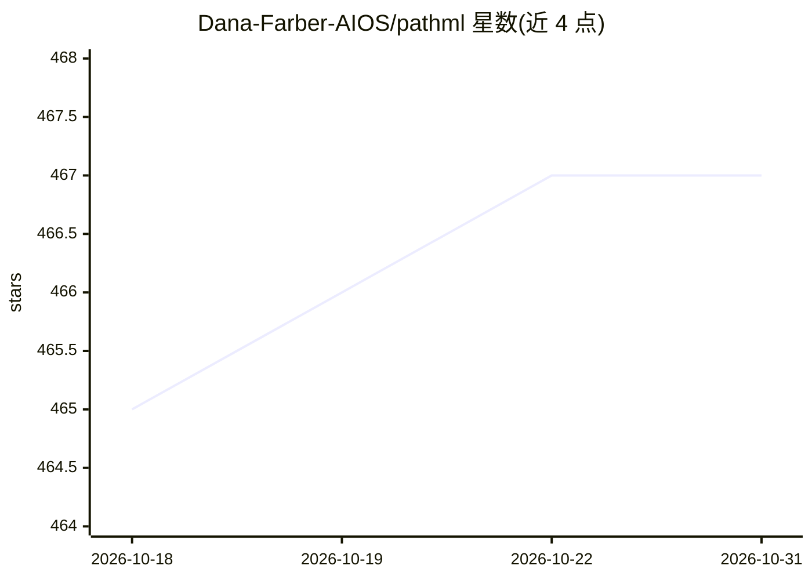

# Dana-Farber-AIOS/pathml

⭐ 467 · Python · GPL-2.0 · 推送 2026-08-14 · [GitHub](https://github.com/Dana-Farber-AIOS/pathml) · [官网](https://pathml.org) · 组织维护

**面向研究者的计算病理学工具包：全切片图像分析与建模**

Dana-Farber 维护的开源 Python 研究工具包，目标是降低数字病理门槛。支持读取 160+ 种病理图像格式，提供 H&E 染色分解与颜色归一化、多参数成像单细胞定量、细胞/组织图构建、HoVer-Net 核检测与 HACTNet 癌症分型训练等流程，可衔接 PyTorch/ONNX 模型。依赖 OpenSlide、Java（openjdk<=18）读取多格式文件，GPU 需自行安装 CUDA（默认 11.6）。提供 pip、conda 环境、Docker、源码与 Colab 多种安装方式。

## 筛选速览

| 维度 | 判定 | 备注 |
|---|---|---|
| AI 角色 | `ai-native` | 本体是模型或模型工具 |
| 许可风险 | `dual` | GPL-2.0 |
| 部署形态 | `self-host` | docker 或自建部署 |
| 模型依赖 | — | README 未给出锁定关系 |
| 硬件要求 | — | 无带数字的原话,不猜 |
| 安装摩擦 | `low` | 无编译、无系统依赖或容器化 |
| 成熟度 | — | 结构信号不足 |

## 能力要点

- 支持读取 160+ 种病理图像格式
- H&E 染色分解、颜色归一化与多参数成像单细胞定量
- Graph API 构建细胞/组织图并训练 HoVer-Net、HACTNet 等模型
- 可运行 ONNX 模型并衔接 PyTorch 分析流程

## 适用场景

- 对全切片病理图像做预处理与批量分析
- 训练和运行核检测、癌症分型的深度学习模型
- 多参数成像（如 CODEX）的单细胞定量分析

## 场景标签

`图像视频处理` · 领域:感知与多模态

## 证据(README 行号)

> L11: ⭐ **PathML objective is to lower the barrier to entry to digital pathology**
> L13: Imaging datasets in cancer research are growing exponentially in both quantity and information density. These massi
> L294: 6. Train HoVer-Net model to perform nucleus detection and classification, using data from PanNuke dataset

## 星数曲线

2026-10-18 465 → 2026-10-31 467（+2）

---
*卡片 v1 · prompt 1.4 · 生成 2026-10-21 · 置信度 high · 依据 README sha `b7390a6c0c1d` · [字段定义](../../DATASET.md)*
