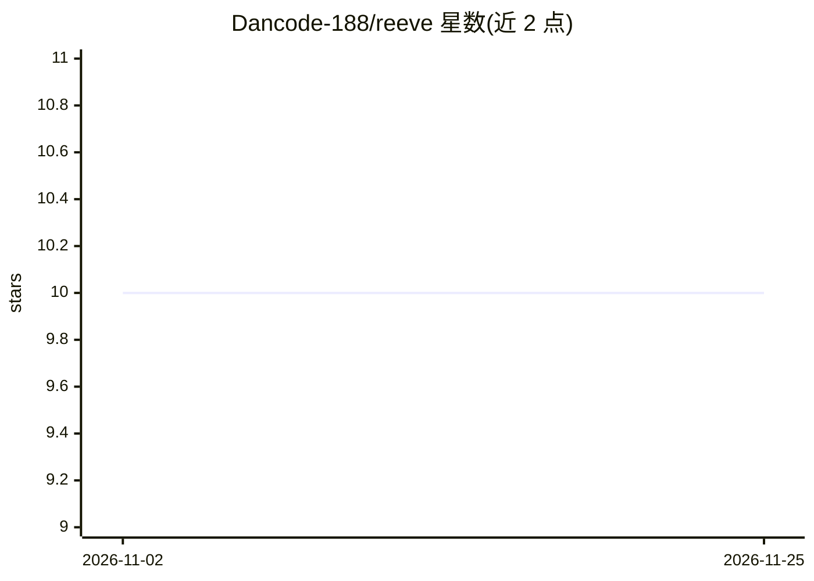

# Dancode-188/reeve

⭐ 10 · Rust · NOASSERTION · 推送 2026-09-06 · [GitHub](https://github.com/Dancode-188/reeve) · 个人维护

**开发者的 AI Agent 终端驾驶舱：实时观测、评分与干预**

以 Rust 编写的终端 TUI 工具，通过 OTel span 或 HTTP 代理接入本地运行的 AI Agent，实时呈现 trace 树。核心机制：毫秒级启发式检查（循环检测、成本、延迟）加本地 Ollama LLM 评分合成 0-100 健康分；支持条件策略规则自动触发，用户可按 i 键暂停、重定向指令、注入上下文或终止 agent；每次干预记录前后健康分差值。限制：仅本地开发者工具，非生产监控 SaaS；不支持原生 Windows（需 WSL）；代理路径无暂停能力。

## 筛选速览

| 维度 | 判定 | 备注 |
|---|---|---|
| AI 角色 | `ai-ecosystem` | LLM/agent 周边工具 |
| 许可风险 | `none` | NOASSERTION |
| 部署形态 | `desktop` | 安装包/桌面程序 |
| 模型依赖 | local-ok | 支持本地模型 |
| 硬件要求 | — | 无带数字的原话,不猜 |
| 安装摩擦 | `medium` | 含编译或系统依赖之一 |
| 成熟度 | — | 结构信号不足 |

## 能力要点

- OTel/HTTP 代理双接入方式，Claude Code 等客户端零代码接入
- 本地 Ollama 评分（faithfulness/hallucination 等），无云路径、无账号、API key 不落盘
- 运行时干预：暂停、重定向、注入上下文、kill 断路器
- 策略规则支持 &&/|| 组合与预测性成本阈值

## 适用场景

- 本地调试陷入循环或跑偏的 agent，实时介入纠偏
- 为零 instrument 的 Claude Code 会话重建 trace 树并观察
- 用健康分与成本规则在预算超支前自动告警
- 回放历史 trace（DVR 式）复盘干预效果

## 场景标签

`LLM 可观测性` · 领域:评测与运维

## 证据(README 行号)

> L7: A terminal cockpit for AI agents. Watch a run live, score it, and step in
> L50: **Watch.** Connect via OTel SDK integration or HTTP proxy. You get a live trace tree
> L165: **Reeve is a local developer tool.** Not a production monitoring SaaS. No account to

## 星数曲线

2026-11-02 10 → 2026-11-25 10（+0）

---
*卡片 v1 · prompt 1.4 · 生成 2026-11-20 · 置信度 high · 依据 README sha `5e9303bfd94c` · [字段定义](../../DATASET.md)*
