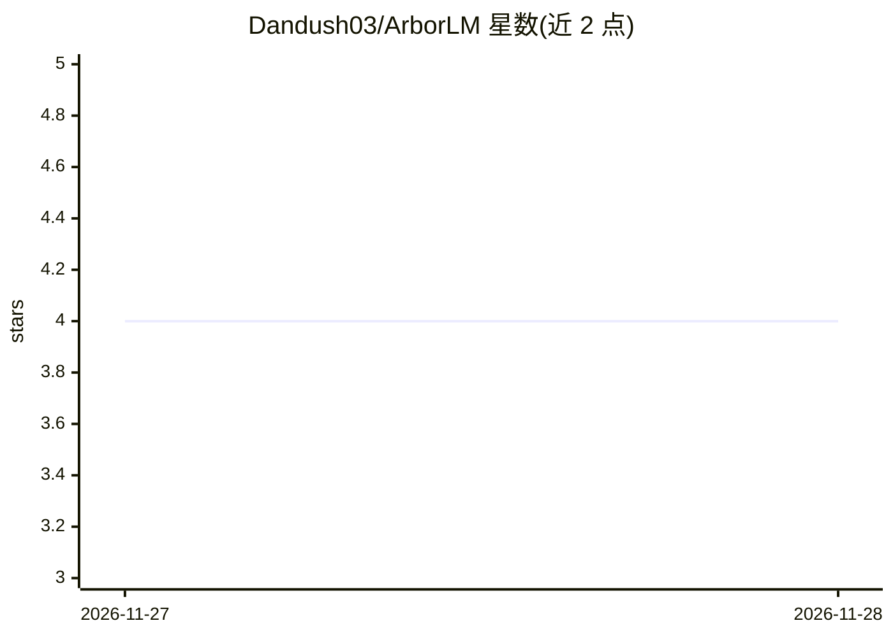

# Dandush03/ArborLM

⭐ 4 · Python · Apache-2.0 · 推送 2026-11-27 · [GitHub](https://github.com/Dandush03/ArborLM) · 个人维护

**面向研究者的语言模型神经记忆开放实验项目**

ArborLM 是一项开放研究：探索带可训练层级神经参数记忆的语言模型，研究稀疏检索、可扩展容量、持续学习与存储高效推理。README 以注册化实验方式记录各阶段（E0 至 P10）结果，包含大量失败与未达标结论、进度评分表，强调可复现实验与预注册判据；多数层级优势假设未获证实，项目明确声明不允许扩大规模。

## 筛选速览

| 维度 | 判定 | 备注 |
|---|---|---|
| AI 角色 | `ai-knowledge` | 知识聚合/清单类 |
| 许可风险 | `permissive` | Apache-2.0 |
| 部署形态 | `None` |  |
| 模型依赖 | — | README 未给出锁定关系 |
| 硬件要求 | — | 无带数字的原话,不猜 |
| 安装摩擦 | `low` | 无编译、无系统依赖或容器化 |
| 成熟度 | — | 结构信号不足 |

## 能力要点

- 预注册判据与注册化实验结果的公开记录
- 包含失败结果与进度评分表的透明研究流程
- 覆盖稀疏检索、容量扩展、SSD 存储局部性模拟等实验

## 适用场景

- 了解神经参数记忆方向的实验设计与失败教训
- 复现注册化实验结果开展后续研究

## 场景标签

`模型训练` `教程课程` · 领域:学习与行业

## 证据(README 行号)

> L5: **ArborLM** is a research proposal for a language model with **trainable hierarchical neural parameter memory**. The
> L7: > **Scientific status: memory helped frozen backbones, but P5 did not establish a hierarchy advantage.** Learned rou

## 星数曲线

2026-11-27 4 → 2026-11-28 4（+0）

---
*卡片 v1 · prompt 1.4 · 生成 2026-11-27 · 置信度 high · 依据 README sha `87f7c4d45110` · [字段定义](../../DATASET.md)*
