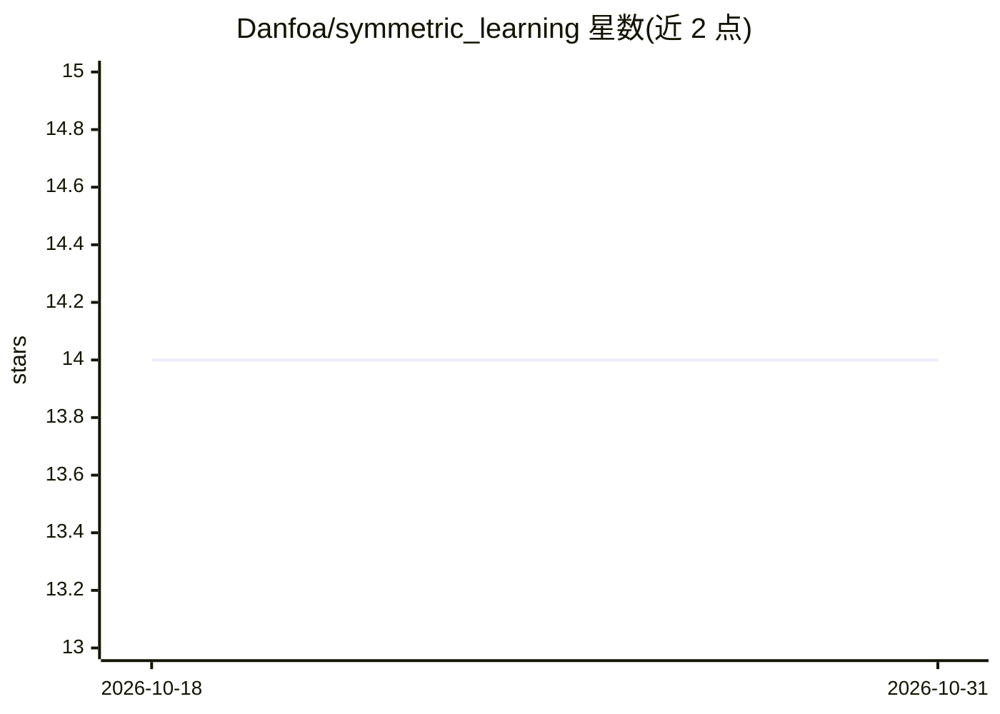

# Danfoa/symmetric_learning

⭐ 14 · Python · MIT · 推送 2026-09-25 · [GitHub](https://github.com/Danfoa/symmetric_learning) · [官网](https://danfoa.github.io/symmetric_learning/) · 个人维护

**面向对称性先验的等变神经网络 PyTorch 库**

基于 PyTorch 的机器学习库，服务于数据带群对称性先验的优化问题。提供等变神经网络层（线性、卷积、归一化、注意力）、即用等变架构（等变 MLP、Transformer、CNN 编码器）、对称向量空间的线性代数工具（等变最小二乘、不变子空间投影）、对称感知统计量与群表示的等距分解等表示论工具。面向需要利用等变性建模的研究者与开发者，通过 pip 安装，文档按分支发布。

## 筛选速览

| 维度 | 判定 | 备注 |
|---|---|---|
| AI 角色 | `ai-native` | 本体是模型或模型工具 |
| 许可风险 | `permissive` | MIT |
| 部署形态 | `library` | 以包/库形式分发 |
| 模型依赖 | — | README 未给出锁定关系 |
| 硬件要求 | — | 无带数字的原话,不猜 |
| 安装摩擦 | `low` | 无编译、无系统依赖或容器化 |
| 成熟度 | — | 结构信号不足 |

## 能力要点

- 等变神经网络层：线性、卷积、归一化、注意力模块
- 即用等变架构：等变 MLP、Transformer、CNN 编码器
- 对称向量空间的等变最小二乘与不变子空间投影
- 群表示的等距分解与到等变线性映射空间的正交投影

## 适用场景

- 构建处理旋转/置换等群对称数据的等变模型
- 在物理、化学等对称性先验问题上做等变建模
- 复用等变线性代数与表示论工具加速研究开发

## 场景标签

 · 领域:几何深度学习/机器学习库

## 证据(README 行号)

> L16: **Symmetric Learning** is a torch-based machine learning library tailored to optimization problems featuring symmet
> L20: - Neural Networks (nn): Equivariant neural network layers including linear, convolutional, normalization, and atten

## 星数曲线

2026-10-18 14 → 2026-10-31 14（+0）

---
*卡片 v1 · prompt 1.4 · 生成 2026-10-31 · 置信度 high · 依据 README sha `d0ace880dbcd` · [字段定义](../../DATASET.md)*
