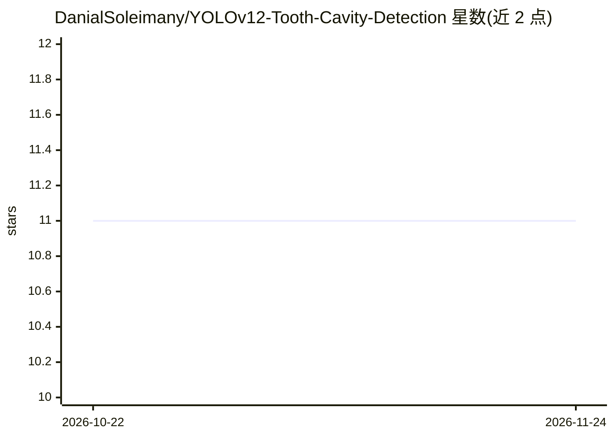

# DanialSoleimany/YOLOv12-Tooth-Cavity-Detection

⭐ 11 · Jupyter Notebook · MIT · 推送 2026-08-06 · [GitHub](https://github.com/DanialSoleimany/YOLOv12-Tooth-Cavity-Detection) · 个人维护

**基于 YOLOv12 的龋齿检测 Web 应用**

以 Flask 为后端的 Web 应用：用户上传牙科影像后，加载预训练的 YOLOv12m 权重（best.pt）在内存中推理，返回带彩色边界框的可视化结果（红框龋齿、绿框正常牙）及置信度条形图，文件不落盘。安装流程为 git clone、建立虚拟环境、pip 安装依赖后运行 app.py；需自行将 best.pt 放入 models/ 目录。图像前端采用 Bootstrap 与 Chart.js，可在浏览器内调节置信度阈值。

## 筛选速览

| 维度 | 判定 | 备注 |
|---|---|---|
| AI 角色 | `ai-native` | 本体是模型或模型工具 |
| 许可风险 | `permissive` | MIT |
| 部署形态 | `library` | 以包/库形式分发 |
| 模型依赖 | — | README 未给出锁定关系 |
| 硬件要求 | — | 无带数字的原话,不猜 |
| 安装摩擦 | `medium` | 含编译或系统依赖之一 |
| 成熟度 | — | 结构信号不足 |

## 能力要点

- YOLOv12m 模型对牙科影像进行龋齿/正常牙二分类检测并绘制边界框
- 图像全部在内存中处理，不在磁盘保存临时或结果文件
- 浏览器内可交互调节置信度阈值并查看概率条形图
- 基于 Flask、Bootstrap、Chart.js 的响应式界面

## 适用场景

- 上传牙科 X 光或照片即时筛查龋齿
- 查看每颗牙齿的分类结果与置信度可视化
- 在本地部署一个不落盘的口腔影像检测演示

## 场景标签

`目标检测` · 领域:感知与多模态

## 证据(README 行号)

> L3: A modern web application for real-time tooth cavity detection using the YOLOv12 deep learning model. This project pr
> L16:  * **YOLOv12**: Ultralytics library for deep learning object detection.
> L22: * **Model**: Pre-trained YOLOv12 model (`best.pt`).

## 星数曲线

2026-10-22 11 → 2026-11-24 11（+0）

---
*卡片 v1 · prompt 1.4 · 生成 2026-11-19 · 置信度 mid · 依据 README sha `737717cbb011` · [字段定义](../../DATASET.md)*
