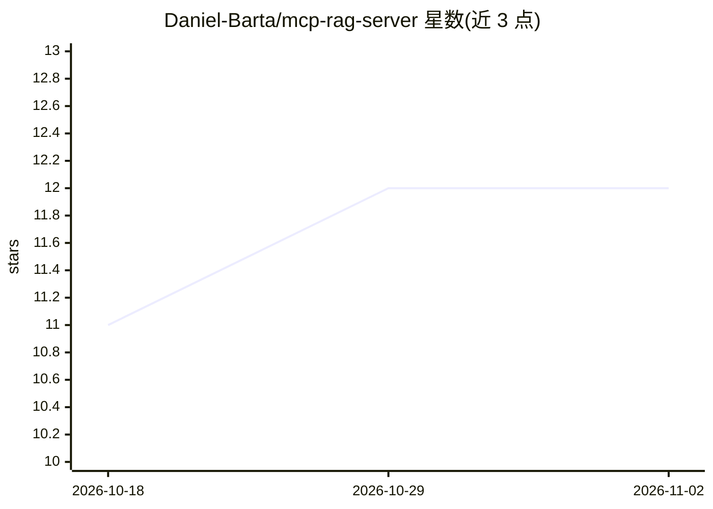

# Daniel-Barta/mcp-rag-server

⭐ 12 · TypeScript · MIT · 推送 2026-05-08 · [GitHub](https://github.com/Daniel-Barta/mcp-rag-server) · 个人维护

**面向 MCP 客户端的轻量级仓库 RAG 检索服务器**

一个基于 Node.js 的 MCP 服务器：索引目标仓库目录，将源码与文档（含 PDF，文本提取后缓存）按可配置的 chunk 切分，用本地 @huggingface/transformers 推理或 OpenAI 兼容 embeddings API 生成向量，再以 MCP 工具形式向 LLM 客户端暴露 rag_query 语义检索、read_file 安全读文件与 list_files 列目录三个工具。支持 stdio 与 Streamable HTTP 两种传输，支持增量重索引与持久化索引的热启动。需要 Node.js 20+，可接入 GitHub Copilot Agent mode、MCP Inspector 等任意 MCP 客户端。

## 筛选速览

| 维度 | 判定 | 备注 |
|---|---|---|
| AI 角色 | `ai-ecosystem` | LLM/agent 周边工具 |
| 许可风险 | `permissive` | MIT |
| 部署形态 | `library` | 以包/库形式分发 |
| 模型依赖 | — | README 未给出锁定关系 |
| 硬件要求 | — | 无带数字的原话,不猜 |
| 安装摩擦 | `low` | 无编译、无系统依赖或容器化 |
| 成熟度 | — | 结构信号不足 |

## 能力要点

- 索引仓库并提供 rag_query/read_file/list_files 三个 MCP 工具
- 本地 transformers 推理或 OpenAI 兼容 embeddings API 两种向量生成方式
- PDF 文本提取缓存与增量变更检测，避免全量重建
- stdio 与 Streamable HTTP 双传输，含 DNS rebinding 防护与路径逃逸拒绝

## 适用场景

- 在 IDE 的 Copilot Agent 模式中对本地代码库做语义检索
- 为 MCP 客户端提供带出处的文档/源码查询能力
- 大型仓库首次索引时用 HTTP 模式观察进度避免客户端超时

## 场景标签

`RAG` · 领域:知识与检索

## 证据(README 行号)

> L3: `mcp-rag-server` is a lightweight Retrieval‑Augmented Generation helper you can plug into **any client that speaks t
> L5: It indexes a target repository directory, chunks the content (default chunk size **2400** characters, about **800** 
> L7: - `rag_query` – semantic search returning scored snippets (path, score, snippet)

## 星数曲线

2026-10-18 11 → 2026-11-02 12（+1）

---
*卡片 v1 · prompt 1.4 · 生成 2026-11-01 · 置信度 high · 依据 README sha `93f12d6c4f7b` · [字段定义](../../DATASET.md)*
