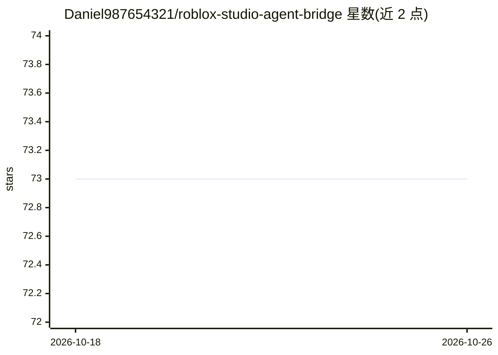

# Daniel987654321/roblox-studio-agent-bridge

⭐ 73 · HTML · 推送 2026-10-25 · [GitHub](https://github.com/Daniel987654321/roblox-studio-agent-bridge) · 组织维护

**面向 Roblox Studio 的 MCP 协作守护进程：让多个编码代理安全共编**

由守护进程（MCP 桥）、Studio 插件、浏览器命令面板与本地加密会话存储四层组成，把 Roblox Studio 的 DataModel 以约 35 个版本化工具（实例读写、脚本补丁、Luau 静态检查、快照/回放、锁与在场、配对握手等）暴露给编码代理。支持多代理同席协作（2-8 席）、流式工具调用、Dry-Run 沙箱与补丁式编辑，配合按键监测与锁协议避免写冲突；默认仅回环网络通信。供 Roblox 开发者与 AI 编码代理协同使用。

## 筛选速览

| 维度 | 判定 | 备注 |
|---|---|---|
| AI 角色 | `ai-ecosystem` | LLM/agent 周边工具 |
| 许可风险 | `none` | — |
| 部署形态 | `None` |  |
| 模型依赖 | — | README 未给出锁定关系 |
| 硬件要求 | — | 无带数字的原话,不猜 |
| 安装摩擦 | `low` | 无编译、无系统依赖或容器化 |
| 成熟度 | — | 结构信号不足 |

## 能力要点

- 35 个版本化 MCP 工具覆盖实例/脚本/资产/会话/锁等操作
- 多代理席位（2-8 席）以锁协议协调，避免同节点写冲突
- 补丁式编辑 + Dry-Run 沙箱 + 按键监测的编辑器安全机制
- 会话快照、diff、逐步回放与可移植归档

## 适用场景

- 让 Claude/Cursor 等编码代理在 Roblox Studio 中安全读写脚本与实例
- 多人多代理同时编辑同一 place 文件并追踪每次变更
- 审计或回放 AI 代理在 Studio 中的全部编辑操作

## 场景标签

`编码 Agent` · 领域:编码与开发

## 证据(README 行号)

> L109: 1. **The Bridge** — a lightweight daemon that speaks the Model Context Protocol and fronts the Studio plugin.
> L110: 2. **The Plugin** — a Studio extension that exposes the DataModel through a capability-scoped API.

## 星数曲线

2026-10-18 73 → 2026-10-26 73（+0）

---
*卡片 v1 · prompt 1.4 · 生成 2026-10-24 · 置信度 mid · 依据 README sha `3ab918aa163f` · [字段定义](../../DATASET.md)*
