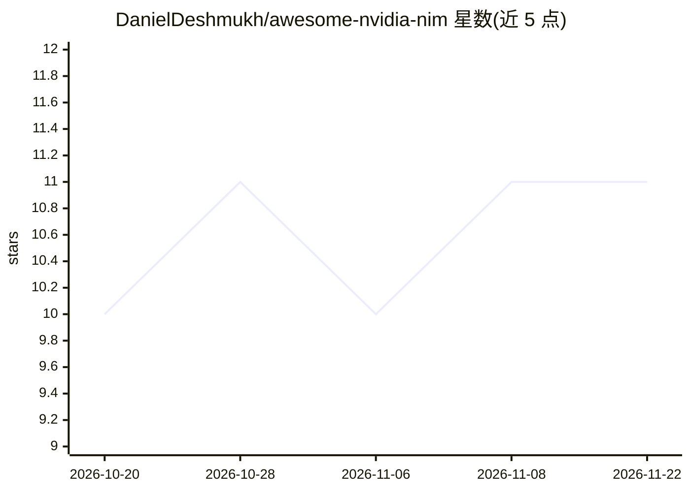

# DanielDeshmukh/awesome-nvidia-nim

⭐ 11 · CC0-1.0 · 推送 2026-07-22 · [GitHub](https://github.com/DanielDeshmukh/awesome-nvidia-nim) · 个人维护

**为用 NVIDIA NIM 构建推理应用的开发者聚合资源清单**

围绕 NVIDIA NIM 推理微服务的资源聚合清单，收录官方文档、快速入门、托管模型目录（LLM/嵌入/视觉/语音类模型标识）、Agent 工作流、RAG 流水线、SDK、框架集成与社区项目等条目。收录标准要求 NIM 为项目的主要推理/嵌入后端。条目按类别组织，多为外链索引，部分社区项目附 pip 安装命令。许可证为 CC0-1.0，接受 PR 投稿。

## 筛选速览

| 维度 | 判定 | 备注 |
|---|---|---|
| AI 角色 | `ai-knowledge` | 知识聚合/清单类 |
| 许可风险 | `viral` | CC0-1.0 |
| 部署形态 | `library` | 以包/库形式分发 |
| 模型依赖 | — | README 未给出锁定关系 |
| 硬件要求 | — | 无带数字的原话,不猜 |
| 安装摩擦 | `low` | 无编译、无系统依赖或容器化 |
| 成熟度 | — | 结构信号不足 |

## 能力要点

- 按官方资源/入门/模型目录/Agent/RAG/SDK/集成等类别组织条目
- 收录标准要求 NIM 为项目主要推理或嵌入后端
- 列出 NIM 托管模型目录及 build.nvidia.com 在线目录入口
- 含 OpenAI Python SDK 兼容用法（base_url 指向 NIM 端点）

## 适用场景

- 查找接入 NVIDIA NIM 的官方文档与入门指南
- 为 Agent 或 RAG 项目挑选基于 NIM 的开源参考实现
- 了解 LangChain/LlamaIndex 等框架的 NIM 集成方式

## 场景标签

`精选清单` · 领域:学习与行业

## 证据(README 行号)

> L14: > A curated list of resources, tools, projects, and workflows for building with NVIDIA NIM — inference microservice
> L18: **Inclusion criteria:** NVIDIA NIM must be central to the project — the primary inference/embedding backend, not on
> L22: ## Contents

## 星数曲线

2026-10-20 10 → 2026-11-22 11（+1）

---
*卡片 v1 · prompt 1.4 · 生成 2026-11-19 · 置信度 mid · 依据 README sha `6e08a0a93a58` · [字段定义](../../DATASET.md)*
