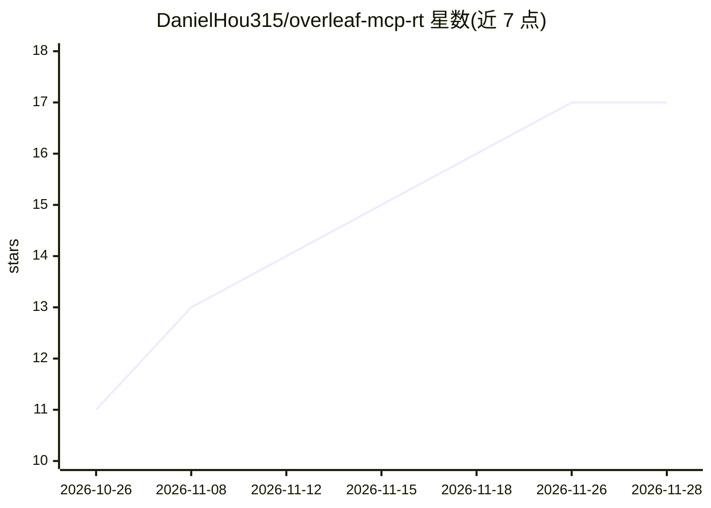

# DanielHou315/overleaf-mcp-rt

⭐ 17 · TypeScript · AGPL-3.0 · 推送 2026-11-17 · [GitHub](https://github.com/DanielHou315/overleaf-mcp-rt) · [官网](https://www.npmjs.com/package/overleaf-mcp-rt) · 个人维护

**让 AI 编码 agent 实时协同编辑 Overleaf LaTeX 项目的 MCP 服务器**

面向 AI 编码 agent（Claude Code、Codex、Cursor 及任意 MCP 客户端）的 Model Context Protocol 服务器与插件：通过 Overleaf 原生 OT 协议接入文档，使 agent 与人在同一文件同时编辑且互不干扰，无需 git-bridge。提供 22 个工具，覆盖项目浏览、读取、精确编辑、评论（Server Pro 与 overleaf.com）、文件管理和编译/取 PDF，并附 4 个 agent 技能。支持 Community Edition 4.x–6.x、Server Pro 与 overleaf.com，可同时登录多个实例；限制如新版文档格式默认只读、CE 无评论面板。以 npm 包 overleaf-mcp-rt 发布，需 Node ≥ 20，Overleaf 服务器端无需安装任何东西。

## 筛选速览

| 维度 | 判定 | 备注 |
|---|---|---|
| AI 角色 | `ai-ecosystem` | LLM/agent 周边工具 |
| 许可风险 | `viral` | AGPL-3.0 |
| 部署形态 | `library` | 以包/库形式分发 |
| 模型依赖 | — | README 未给出锁定关系 |
| 硬件要求 | — | 无带数字的原话,不猜 |
| 安装摩擦 | `low` | 无编译、无系统依赖或容器化 |
| 成熟度 | — | 结构信号不足 |

## 能力要点

- 通过 Overleaf 原生 OT 协议实时编辑，约 100ms 内在编辑器可见，与人工编辑并存无冲突
- 22 个工具：读取、精确字符串编辑、评论、文件管理、编译与 PDF 下载
- 无需 git-bridge，支持 Community Edition、Server Pro 与 overleaf.com
- 一个服务器可同时登录多个 Overleaf 实例

## 适用场景

- 让 AI agent 直接在 Overleaf 上修改论文并实时看到结果
- 让 agent 定位并修复 LaTeX 编译错误、下载 PDF
- agent 与合作者同时编辑同一份文档而不产生合并冲突

## 场景标签

 · 领域:开发者工具/LaTeX 协作

## 证据(README 行号)

> L10: Overleaf MCP lets AI coding agents read, edit, comment on and compile LaTeX projects on your own Overleaf server or
> L16: It is published on npm as `overleaf-mcp-rt` (`rt` for real-time) and works with any MCP client.

## 星数曲线

2026-10-26 11 → 2026-11-28 17（+6）

---
*卡片 v1 · prompt 1.4 · 生成 2026-11-18 · 置信度 high · 依据 README sha `333e3a0839dc` · [字段定义](../../DATASET.md)*
