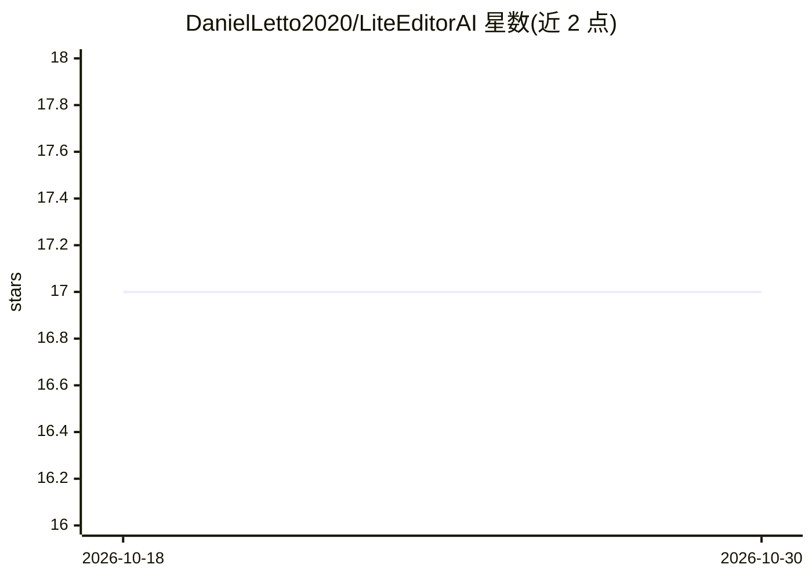

# DanielLetto2020/LiteEditorAI

⭐ 17 · JavaScript · Apache-2.0 · 推送 2026-10-22 · [GitHub](https://github.com/DanielLetto2020/LiteEditorAI) · [官网](https://lite-editor-ai.ru) · 个人维护 · 中文 README

**监督 AI 编程 agent 的终端优先桌面工作区**

基于 Electron 的跨平台（Linux/Windows/macOS）桌面工作区，面向通过 Claude Code、Codex、Gemini CLI 等 agent 写代码的开发者：每项目多 shell 标签页内嵌 agent 终端，以红绿灯状态显示 agent 工作/等待/完成，并聚合阻塞计数。附带代码查看器与完整 Git 界面、CLAUDE.md 分节编辑与版本历史、`.claude` 文件管理、与自有服务器经 SSH/rsync 的项目同步，以及 20+ 工具模块（Docker/Podman 容器、任务看板、审计等）。声明 Status: alpha。提供预编译安装包与 npm 源码运行两种方式。

## 筛选速览

| 维度 | 判定 | 备注 |
|---|---|---|
| AI 角色 | `ai-ecosystem` | LLM/agent 周边工具 |
| 许可风险 | `permissive` | Apache-2.0 |
| 部署形态 | `desktop` | 安装包/桌面程序 |
| 模型依赖 | — | README 未给出锁定关系 |
| 硬件要求 | — | 无带数字的原话,不猜 |
| 安装摩擦 | `low` | 无编译、无系统依赖或容器化 |
| 成熟度 | `idea` | |

## 能力要点

- 每项目 live shell 标签页与 agent 状态红绿灯（working/waiting/done）
- Project 窗口：代码查看器 + Git（staging/cherry-pick/冲突解决/本地文件历史回滚）
- Context 模块：CLAUDE.md 分节管理（token 权重、50 份版本历史）与 Claude 记忆/会话挖掘
- 自有服务器 SSH/rsync 同步与 20+ 工具模块（容器、任务、AI company 多 agent 团队等）

## 适用场景

- 同时监督多个项目里运行的 AI 编程 agent，快速响应等待我的 agent
- 在同一个窗口里查看 agent 改动、diff 与回滚文件
- 管理 agent 的 CLAUDE.md 上下文与 Claude Code 记忆

## 场景标签

`多智能体` · 领域:Agent 开发

## 证据(README 行号)

> L5: A terminal-first desktop workspace for developers who **supervise AI coding agents**
> L6: (Claude Code, Codex, Gemini CLI, Qwen…) instead of typing every line themselves.
> L54: next one. Notifications included. For Claude Code the light doesn't guess from the output: Claude reports its

## 星数曲线

2026-10-18 17 → 2026-10-30 17（+0）

---
*卡片 v1 · prompt 1.4 · 生成 2026-10-30 · 置信度 high · 依据 README sha `b27d1397a4ee` · [字段定义](../../DATASET.md)*
