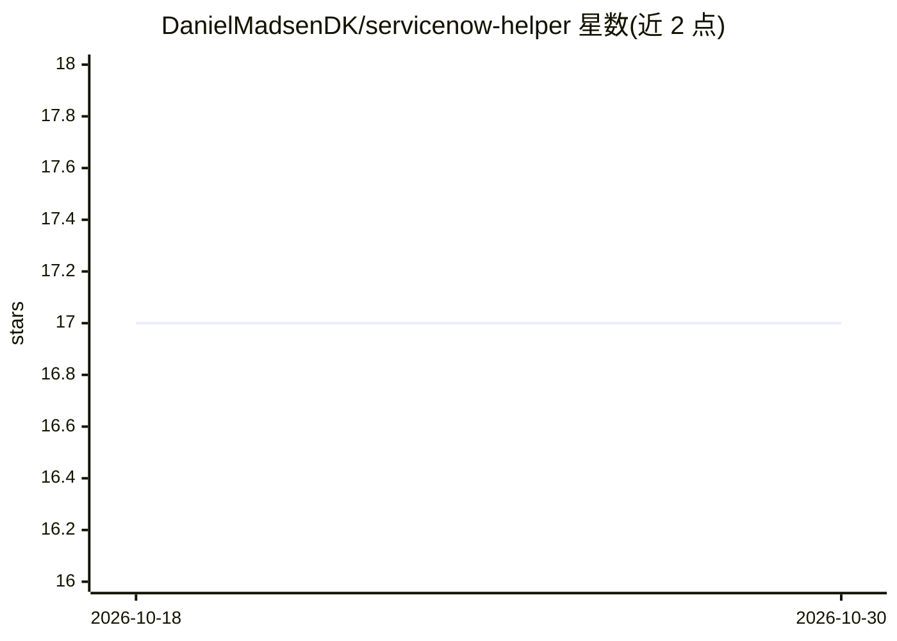

# DanielMadsenDK/servicenow-helper

⭐ 17 · TypeScript · MIT · 推送 2026-02-13 · [GitHub](https://github.com/DanielMadsenDK/servicenow-helper) · 个人维护

**面向 ServiceNow 用户的多 agent AI 问答与脚本生成 Web 工具**

基于 Next.js 与 n8n 工作流的自托管 Web 应用：提供 9 个可独立配置模型的专用 AI agent（规划、编码、架构等），通过 OpenRouter、Hugging Face 等多供应商接入模型，以 SSE 流式实时返回 ServiceNow 文档、最佳实践建议、Business Rules/Client Scripts 脚本生成与故障排查答案，支持语音输入转写、多模态附件、Mermaid 图表生成、答案导出 Markdown/PDF 及脚本一键部署到 ServiceNow。内置 JWT 认证、PostgreSQL+pgvector 存储与对话/知识库管理。通过 Docker Compose 一键部署，n8n 界面与主应用一并启动。

## 筛选速览

| 维度 | 判定 | 备注 |
|---|---|---|
| AI 角色 | `ai-native` | 本体是模型或模型工具 |
| 许可风险 | `permissive` | MIT |
| 部署形态 | `self-host` | docker 或自建部署 |
| 模型依赖 | locked-api |  |
| 硬件要求 | — | 无带数字的原话,不猜 |
| 安装摩擦 | `low` | 无编译、无系统依赖或容器化 |
| 成熟度 | — | 结构信号不足 |

## 能力要点

- 9 个专用 AI agent，各自可配置不同供应商与模型
- 流式实时回答，支持语音转写输入与多模态附件（图片/PDF/音频）
- 生成的 Business Rules、Client Scripts 等可一键部署到 ServiceNow 实例
- Docker Compose 一键部署，含 n8n 工作流引擎与 PostgreSQL/pgvector

## 适用场景

- ServiceNow 管理员/开发者查询文档、生成并部署脚本
- 运维团队做故障排查与最佳实践咨询
- 沉淀常见问答到知识库供团队复用

## 场景标签

`多智能体` `代码生成` `文档问答` · 领域:Agent 开发

## 证据(README 行号)

> L14: *An intelligent ServiceNow assistance tool featuring **multi-agent AI architecture** with **multiple AI provider su
> L18: - **Multi-Agent AI Architecture** - 9 specialized AI agents (Orchestration, Planner, Coder, Architect, Process SME)
> L100: 3. **Ask questions** with real-time streaming responses (text or voice input)

## 星数曲线

2026-10-18 17 → 2026-10-30 17（+0）

---
*卡片 v1 · prompt 1.4 · 生成 2026-10-30 · 置信度 high · 依据 README sha `b977b0a760a1` · [字段定义](../../DATASET.md)*
