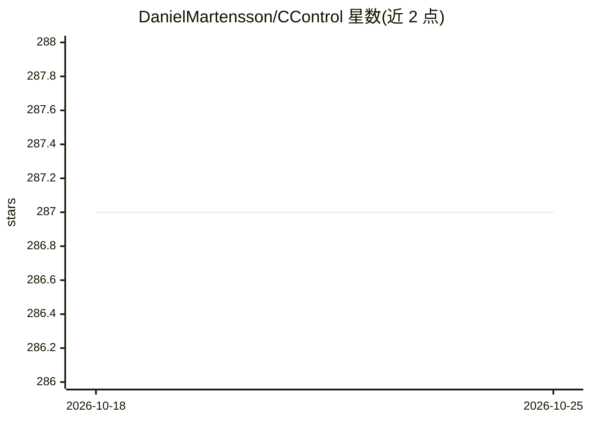

# DanielMartensson/CControl

⭐ 287 · C · MIT · 推送 2026-06-15 · [GitHub](https://github.com/DanielMartensson/CControl) · 个人维护

**面向嵌入式与桌面的 ANSI C 控制/视觉/机器学习算法库**

以 C89 编写、CMake 标准 C17 构建的数值与算法库，覆盖线性代数、优化、统计、信号处理、系统辨识、控制工程（MPC、卡尔曼滤波、LQR）、机器学习（SVM、神经网络、K-means、AdaBoost）与计算机视觉（Hough 变换、Harris 角点、Fisherfaces、Viola Jones）。后端数学库可在内部轻量库、MKL、CLAPACK、FFTPACK 间切换，以适配从 Arduino/STM32/PIC 到桌面系统的场景。README 附带多个基于该库的硬件控制项目（烙铁温控、风机控制、CAN 总线 MRAC 等）。

## 筛选速览

| 维度 | 判定 | 备注 |
|---|---|---|
| AI 角色 | `ai-native` | 本体是模型或模型工具 |
| 许可风险 | `permissive` | MIT |
| 部署形态 | `desktop` | 安装包/桌面程序 |
| 模型依赖 | — | README 未给出锁定关系 |
| 硬件要求 | — | 无带数字的原话,不猜 |
| 安装摩擦 | `medium` | 含编译或系统依赖之一 |
| 成熟度 | — | 结构信号不足 |

## 能力要点

- 100% ANSI C (C89) 编写，适配 Arduino/STM32/PIC 等小型嵌入式设备
- 四类可选数学后端：内部轻量库、MKL、CLAPACK、FFTPACK
- 包含 MPC、卡尔曼滤波、SVM、神经网络、Hough 变换等实现
- 附 STM32 烙铁温控、风机控制、CAN 总线 MRAC 等实际项目案例

## 适用场景

- 在资源受限的微控制器上实现模型预测控制与状态估计
- 嵌入式设备上运行轻量级视觉算法（角点检测、目标检测）
- 桌面系统上结合 MKL 后端处理大规模矩阵运算
- 通过系统辨识方法（OKID、ERA）建立控制对象的状态空间模型

## 场景标签

 · 领域:嵌入式系统/控制与视觉算法

## 证据(README 行号)

> L44: CControl have sevral algorithms for computer vision. They are chosen and reduced so they will fit embedded systems.
> L61: - Machine Learning
> L64:  - Kernel for PCA and LDA

## 星数曲线

2026-10-18 287 → 2026-10-25 287（+0）

---
*卡片 v1 · prompt 1.4 · 生成 2026-10-22 · 置信度 high · 依据 README sha `83a517770d5d` · [字段定义](../../DATASET.md)*
