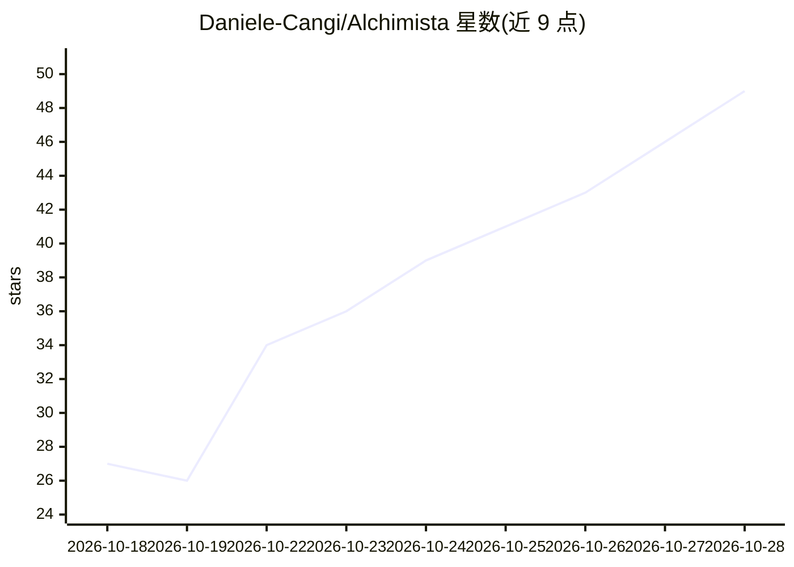

# Daniele-Cangi/Alchimista

⭐ 49 · Python · AGPL-3.0 · 推送 2026-08-19 · [GitHub](https://github.com/Daniele-Cangi/Alchimista) · 个人维护

**自托管 AI 治理与文档智能平台：带引用的 RAG 问答与隐私审计**

基于 Docker Compose 的自托管基础设施层：摄取本地文档，构建租户隔离的检索索引，通过 Ask 界面或 API 返回带强制引用与置信度的跨文档回答，并记录 AI 决策证据与隐私元数据供审计。隐私层提供 off/detect/protect_egress/strict 四级策略，集成 Rizzo-PII 检测器（轻量正则版内置，Full Rizzo 0.3B 模型可在界面安装），PII 经 AES-256-GCM 加密保管。基线仅需 Docker 与 Python 3.11，无外部付费服务；GCP/Vertex/Pub/Sub/OIDC 为可选适配器。README 声明其实现的是技术控制，不认证 GDPR 或 AI Act 合规。

## 筛选速览

| 维度 | 判定 | 备注 |
|---|---|---|
| AI 角色 | `ai-native` | 本体是模型或模型工具 |
| 许可风险 | `viral` | AGPL-3.0 |
| 部署形态 | `self-host` | docker 或自建部署 |
| 模型依赖 | — | README 未给出锁定关系 |
| 硬件要求 | — | 无带数字的原话,不猜 |
| 安装摩擦 | `low` | 无编译、无系统依赖或容器化 |
| 成熟度 | — | 结构信号不足 |

## 能力要点

- 租户隔离的 RAG 问答，回答带可点击引用与置信度
- 四级隐私策略（off/detect/protect_egress/strict），fail-closed 设计
- AES-256-GCM 加密的 PII 保管库与级联删除，决策证据伪匿名化入审计
- 本地基线零外部依赖，GCP/Vertex/OIDC 为可选适配器

## 适用场景

- 把内部文档建成带引用溯源的私有问答库
- 对含个人数据的文档先脱敏再检索与调用外部模型
- 留存可审计的 AI 决策证据与隐私处理记录

## 场景标签

`文档问答` · 领域:知识与检索

## 证据(README 行号)

> L5: Alchimista is a self-hostable AI governance, document intelligence, RAG,
> L7: tenant-scoped retrieval index, returns mandatory citations, and records AI
> L118:  Ask — cross-document answers with clickable evidence

## 星数曲线

2026-10-18 27 → 2026-10-28 49（+22）

---
*卡片 v1 · prompt 1.4 · 生成 2026-10-25 · 置信度 mid · 依据 README sha `9bee06b15547` · [字段定义](../../DATASET.md)*
