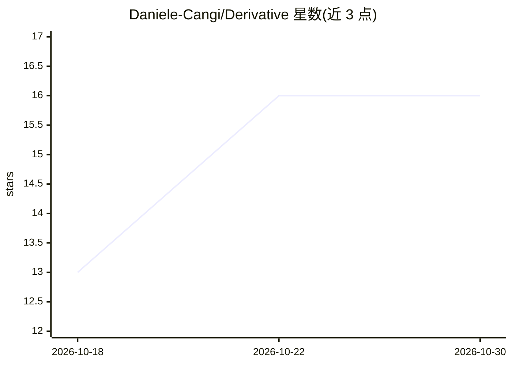

# Daniele-Cangi/Derivative

⭐ 16 · Python · MIT · 推送 2026-10-10 · [GitHub](https://github.com/Daniele-Cangi/Derivative) · 个人维护

**从自然语言需求生成 Python 软件并独立验证后打包的工具**

Derivative（底层推理基座）与 Forge（软件构建流水线）两层组成：输入自然语言需求，编译为结构化契约，生成 Python 实现（CLI/REST/数据管道/库），在无网络、只读根文件系统的 Docker 沙箱中执行，经独立校验（语法/运行、契约、对抗检查）后才打包；未通过则 fail-closed 为 validation_failed，约束矛盾时输出不可行性证明证书。面向开发者，需 Python 3.11 与 Docker，支持确定性模式（无 API key）与 OpenAI 混合模式。当前明确不覆盖已有仓库编辑、其他语言与前端。README 附带冻结盲测基准记录（V11 外部验证 0/6）。

## 筛选速览

| 维度 | 判定 | 备注 |
|---|---|---|
| AI 角色 | `ai-native` | 本体是模型或模型工具 |
| 许可风险 | `permissive` | MIT |
| 部署形态 | `self-host` | docker 或自建部署 |
| 模型依赖 | — | README 未给出锁定关系 |
| 硬件要求 | — | 无带数字的原话,不猜 |
| 安装摩擦 | `low` | 无编译、无系统依赖或容器化 |
| 成熟度 | — | 结构信号不足 |

## 能力要点

- 需求→契约→实现→沙箱执行→独立验证→打包的 fail-closed 流水线
- verified/validation_failed/infeasible_proven 三种构建终态
- 12 种可选能力安装配置（SymPy/Z3/pgmpy/Qiskit 等推理运行时）
- 每次运行输出类型化证据工件（build_spec、验证结果、修复计数）

## 适用场景

- 从自然语言描述生成带测试的 Python CLI 或 REST 服务
- 要求生成代码在隔离沙箱中通过独立验证后再交付
- 获得约束矛盾时的不可行性证明证书而非勉强实现

## 场景标签

`代码生成` · 领域:编码与开发

## 证据(README 行号)

> L15: Give Derivative a natural-language software requirement. **Forge** turns it into a structured contract, builds a Py
> L34: Forge does not simply generate a plausible implementation and return it. The candidate must satisfy executable requ
> L54: **Derivative** is the broader computational reasoning substrate behind this process. **Forge** is the software-buil

## 星数曲线

2026-10-18 13 → 2026-10-30 16（+3）

---
*卡片 v1 · prompt 1.4 · 生成 2026-10-30 · 置信度 high · 依据 README sha `5d7a09c42b87` · [字段定义](../../DATASET.md)*
