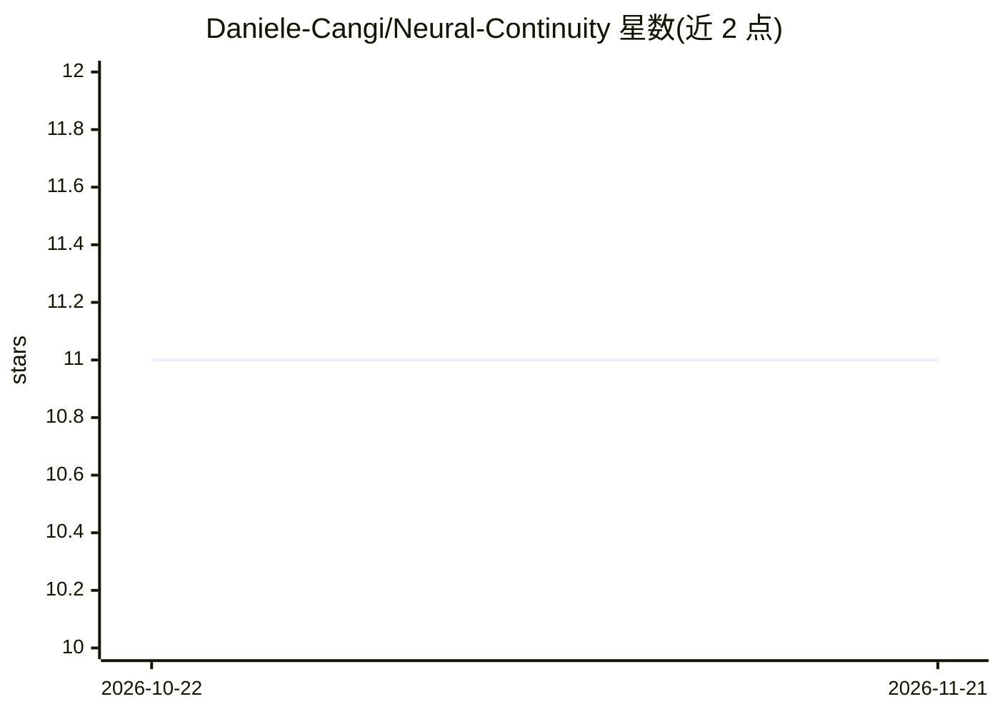

# Daniele-Cangi/Neural-Continuity

⭐ 11 · Python · MIT · 推送 2026-11-03 · [GitHub](https://github.com/Daniele-Cangi/Neural-Continuity) · 个人维护

**检验模型转换/量化后行为是否保持的评估框架**

面向模型转换场景的评估框架：对源模型与候选模型（如 PyTorch FP32 → ONNX、INT8 量化）的声明转换进行行为保持性检验。机制包括评估前冻结契约与容差、嵌入/表示漂移与检索排序保持测量、SHA-256 证据打包、无需重跑模型的回放复现，输出 PASS/FAIL/INCONCLUSIVE 三种科学判定，并将执行失败（BLOCKED/EXECUTION_ERROR）与科学结论分离。以 Python 包形式提供，含 CLI 与实验配置目录。

## 筛选速览

| 维度 | 判定 | 备注 |
|---|---|---|
| AI 角色 | `ai-ecosystem` | LLM/agent 周边工具 |
| 许可风险 | `permissive` | MIT |
| 部署形态 | `library` | 以包/库形式分发 |
| 模型依赖 | — | README 未给出锁定关系 |
| 硬件要求 | — | 无带数字的原话,不猜 |
| 安装摩擦 | `medium` | 含编译或系统依赖之一 |
| 成熟度 | — | 结构信号不足 |

## 能力要点

- 评估前冻结契约，候选不得事后重定义容差
- SHA-256 证据清单与防篡改证据包
- 无需重跑模型的确定性回放
- PASS/FAIL/INCONCLUSIVE 与 BLOCKED/EXECUTION_ERROR 分层判定

## 适用场景

- 验证 ONNX 导出或 INT8 量化后的模型是否保持功能行为
- 为模型转换实验生成可复现的证据包
- 团队审查转换模型是否越过预注册容差

## 场景标签

`模型评测` `MLOps` · 领域:评测与运维

## 证据(README 行号)

> L21: **Evidence-driven research framework for testing whether model transformations preserve declared operational behavi
> L23: Neural Continuity evaluates a declared transition between a source model and a candidate. It freezes the contract b
> L76: |Scientific decision|Did behavior remain inside the frozen operational boundary?|`PASS`, `FAIL`, `INCONCLUSIVE`|

## 星数曲线

2026-10-22 11 → 2026-11-21 11（+0）

---
*卡片 v1 · prompt 1.4 · 生成 2026-11-19 · 置信度 high · 依据 README sha `b14c39c30a53` · [字段定义](../../DATASET.md)*
