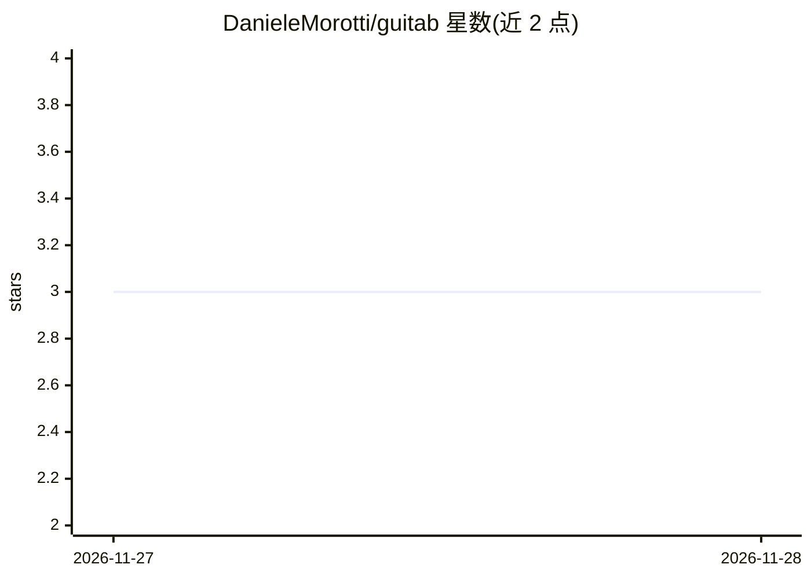

# DanieleMorotti/guitab

⭐ 3 · Python · MIT · 推送 2026-10-31 · [GitHub](https://github.com/DanieleMorotti/guitab) · [官网](https://danielemorotti.github.io/guitab/) · 个人维护

**把独奏吉他录音转成 gp5 吉他谱的本地转录工具**

面向指弹吉他手的音频转录工具：输入录音（手机视频亦可），输出可在 Guitar Pro、TuxGuitar、MuseScore 中打开的 .gp5 文件，含弦/品位置、节拍网格与可选变调夹标注。提供 Python CLI、本地 Web 应用（录制/上传/回放，alphaTab 查看器）以及无需安装的浏览器版本（ONNX Runtime Web，音频不出设备）。模型权重托管于 Hugging Face 并按需自动下载。针对钢弦指弹训练；干净录音约 85% 音符正确，密集和弦与混响手机录音误差大，作者定位为需人工校对的初稿。

## 筛选速览

| 维度 | 判定 | 备注 |
|---|---|---|
| AI 角色 | `ai-native` | 本体是模型或模型工具 |
| 许可风险 | `permissive` | MIT |
| 部署形态 | `desktop` | 安装包/桌面程序 |
| 模型依赖 | — | README 未给出锁定关系 |
| 硬件要求 | `cpu-ok` | |
| 安装摩擦 | `medium` | 含编译或系统依赖之一 |
| 成熟度 | — | 结构信号不足 |

## 能力要点

- 音频转录为 .gp5 文件，含弦/品、节拍网格与变调夹
- CLI、本地 Web 应用与纯浏览器三个运行形态，浏览器版输出与 Python 版逐字节一致
- E25（6M 参数，蒸馏）默认模型，另有 2.9M 参数的 tiny 模型
- --music_lm 用符号谱语言模型补全 3–4 音和弦

## 适用场景

- 把自己的指弹录音转成可编辑的吉他谱初稿
- 在浏览器中录制并即时转录，无需安装
- 对练习视频生成可视化的弦位标注

## 场景标签

 · 领域:音频/音乐信息检索

## 证据(README 行号)

> L7: Guitab turns a recording of a solo guitar into a tab you can open in Guitar Pro, TuxGuitar, MuseScore or any online 
> L112: `docs/` is a static page that does the whole transcription in the browser, so *the audio never leaves the device*.

## 星数曲线

2026-11-27 3 → 2026-11-28 3（+0）

---
*卡片 v1 · prompt 1.4 · 生成 2026-11-27 · 置信度 high · 依据 README sha `646e5f589966` · [字段定义](../../DATASET.md)*
