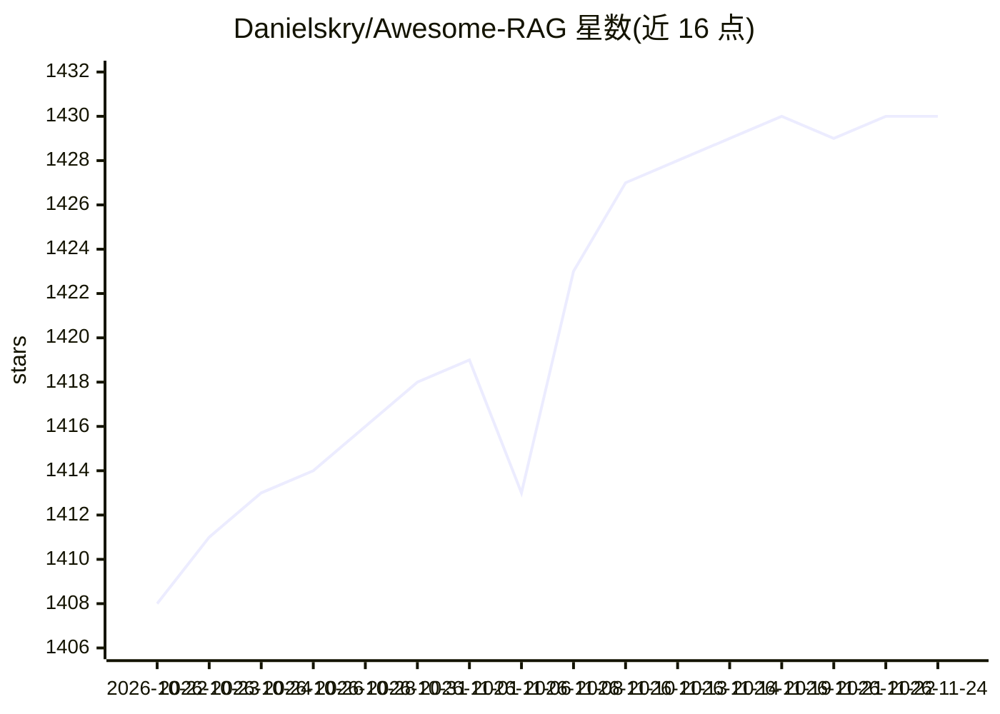

# Danielskry/Awesome-RAG

⭐ 1,430 · CC0-1.0 · 推送 2026-11-23 · [GitHub](https://github.com/Danielskry/Awesome-RAG) · 个人维护

**RAG 系统构建资源地图：工具、框架、技术与教程目录**

一份面向构建检索增强生成（RAG）系统开发者的策展资源清单：收录 RAG 基础知识、架构模式（Naive/Advanced/Agentic/Graph RAG 等）、进阶方法（CRAG、RAFT、VideoRAG 等）、框架目录、Python 生态、提示词与分块技术的链接与简介。内容以 VS Code、GitHub Copilot CLI 与 Claude Code 的 Agent Plugin 形式提供，并可通过 DeepWiki 询问。本体为教程/资源集，本身不产出模型输出。

## 筛选速览

| 维度 | 判定 | 备注 |
|---|---|---|
| AI 角色 | `ai-knowledge` | 知识聚合/清单类 |
| 许可风险 | `viral` | CC0-1.0 |
| 部署形态 | `None` |  |
| 模型依赖 | — | README 未给出锁定关系 |
| 硬件要求 | — | 无带数字的原话,不猜 |
| 安装摩擦 | `low` | 无编译、无系统依赖或容器化 |
| 成熟度 | — | 结构信号不足 |

## 能力要点

- 按架构模式、进阶方法、框架、技术分类组织的 RAG 资源目录
- 以 Agent Plugin 形式可在 VS Code / GitHub Copilot CLI / Claude Code 中使用
- 覆盖分块策略、提示词策略等实现级技术说明
- 提供 DeepWiki 仓库问答入口

## 适用场景

- 搭建 RAG 应用前查找合适的框架与教程
- 了解 RAG 架构模式与进阶方法的全景
- 为团队整理 RAG 工程最佳实践参考资料

## 场景标签

`RAG` `精选清单` · 领域:知识与检索

## 证据(README 行号)

> L4: A curated resource map of tools, frameworks, techniques, and learning materials for building Retrieval-Augmented Gen
> L6: Also available as an Agent Plugin for VS Code, GitHub Copilot CLI, and Claude Code.

## 星数曲线

2026-10-22 1,408 → 2026-11-24 1,430（+22）

---
*卡片 v1 · prompt 1.4 · 生成 2026-11-24 · 置信度 high · 依据 README sha `c367b3534bb6` · [字段定义](../../DATASET.md)*
