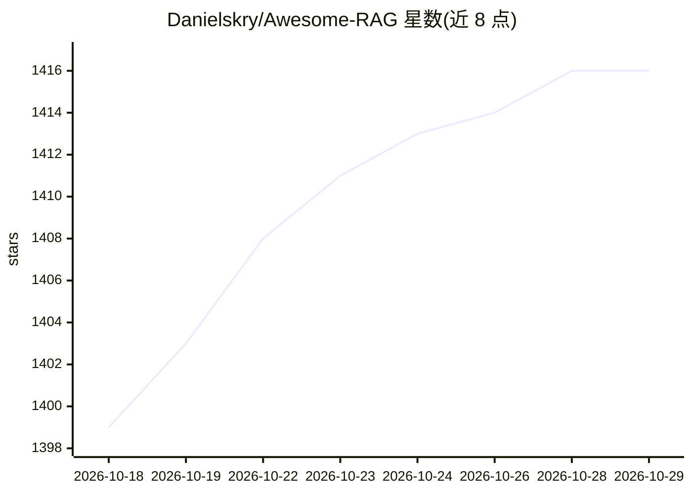

# Danielskry/Awesome-RAG

⭐ 1,416 · CC0-1.0 · 推送 2026-10-06 · [GitHub](https://github.com/Danielskry/Awesome-RAG) · 个人维护

**RAG 生态策展清单：工具、框架、技术与学习资源导航**

Awesome 风格的检索增强生成（RAG）资源清单，面向构建 RAG 应用的开发者与学习者：收录 Python 教程与示例、生产实践指南、七种架构模式（Naive/Agentic/Self-RAG/GraphRAG 等）、二十余种进阶技术（CRAG、RAFT、VideoRAG、PageIndex 等），并列出 Haystack、LangChain、Dify、LlamaIndex 等框架与 Python 生态条目；另含分块策略、提示工程等技术说明。仓库本身还以 VS Code、GitHub Copilot CLI 与 Claude Code 的 Agent Plugin 形式提供，可通过 DeepWiki 提问。

## 筛选速览

| 维度 | 判定 | 备注 |
|---|---|---|
| AI 角色 | `ai-knowledge` | 知识聚合/清单类 |
| 许可风险 | `viral` | CC0-1.0 |
| 部署形态 | `None` |  |
| 模型依赖 | — | README 未给出锁定关系 |
| 硬件要求 | — | 无带数字的原话,不猜 |
| 安装摩擦 | `low` | 无编译、无系统依赖或容器化 |
| 成熟度 | — | 结构信号不足 |

## 能力要点

- 覆盖 7 种 RAG 架构模式与 20+ 进阶技术条目
- 收录 Haystack/LangChain/Dify/LlamaIndex 等 18 个 RAG 相关框架
- 含分块策略（固定/递归/文档/语义）与提示工程技术说明
- 以 VS Code、GitHub Copilot CLI、Claude Code 的 Agent Plugin 形式提供

## 适用场景

- 入门时系统了解 RAG 的概念、模式与实现路径
- 选型时查找 RAG 框架、向量库与生产实践参考
- 查找分块与提示工程等具体技术的实现指引

## 场景标签

`精选清单` `RAG` `教程课程` · 领域:知识与检索

## 证据(README 行号)

> L4: A curated resource map of tools, frameworks, techniques, and learning materials for building Retrieval-Augmented Gen
> L88: - Haystack: LLM orchestration framework to build customizable, production-ready LLM applications.

## 星数曲线

2026-10-18 1,399 → 2026-10-29 1,416（+17）

---
*卡片 v1 · prompt 1.4 · 生成 2026-10-21 · 置信度 high · 依据 README sha `57d489bd9403` · [字段定义](../../DATASET.md)*
