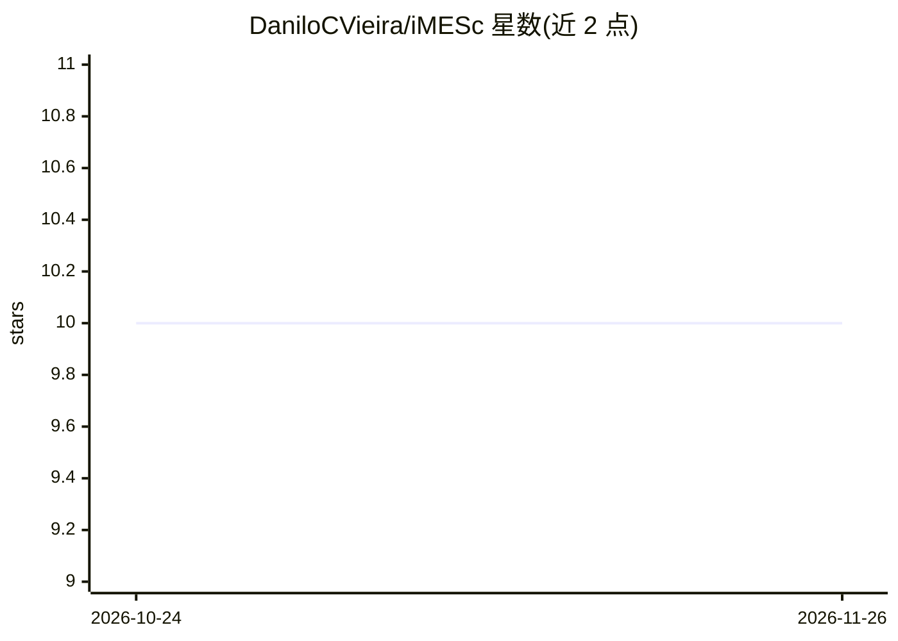

# DaniloCVieira/iMESc

⭐ 10 · R · NOASSERTION · 推送 2026-11-25 · [GitHub](https://github.com/DaniloCVieira/iMESc) · 个人维护

**面向环境科学的交互式机器学习数据分析应用**

基于 R Shiny 的交互式应用，将多种机器学习技术整合到统一界面中，用于探索多变量数据集。主题覆盖监督学习（KNN、朴素贝叶斯、随机森林、支持向量机、随机梯度提升）与无监督学习（自组织映射）。提供两种运行方式：在 RStudio 中通过 runGitHub 直接启动（首次运行自动安装依赖包），或使用官方 Docker 镜像在浏览器访问。采用 CC BY-NC-ND 4.0 许可，附用户手册指导数据格式准备。

## 筛选速览

| 维度 | 判定 | 备注 |
|---|---|---|
| AI 角色 | `ai-native` | 本体是模型或模型工具 |
| 许可风险 | `none` | NOASSERTION |
| 部署形态 | `self-host` | docker 或自建部署 |
| 模型依赖 | — | README 未给出锁定关系 |
| 硬件要求 | — | 无带数字的原话,不猜 |
| 安装摩擦 | `low` | 无编译、无系统依赖或容器化 |
| 成熟度 | — | 结构信号不足 |

## 能力要点

- 交互式界面运行多种监督/无监督学习算法
- RStudio 中 runGitHub 一键启动，首次运行自动安装依赖
- 提供含全部依赖的 Docker 镜像
- 提供用户手册指导自定义数据集格式

## 适用场景

- 对环境科学多变量数据集做监督分类建模
- 用自组织映射等无监督方法探索数据结构
- 不熟悉 R 的用户通过 Docker 在浏览器中运行分析

## 场景标签

`数据分析` · 领域:效率与自动化

## 证据(README 行号)

> L1: # iMESc: Interactive Machine Learning App for Environmental Sciences
> L3: iMESc is a state-of-the-art application designed to bring the power of machine learning to environmental science. Th

## 星数曲线

2026-10-24 10 → 2026-11-26 10（+0）

---
*卡片 v1 · prompt 1.4 · 生成 2026-11-20 · 置信度 high · 依据 README sha `98080c59c0fe` · [字段定义](../../DATASET.md)*
