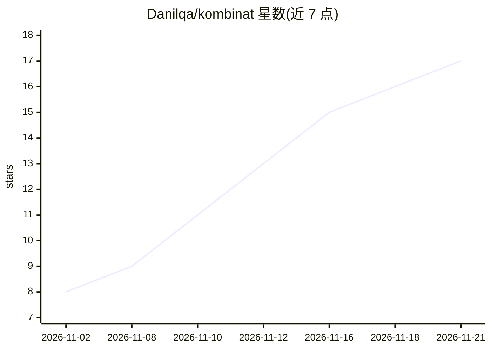

# Danilqa/kombinat

⭐ 17 · TypeScript · MIT · 推送 2026-11-20 · [GitHub](https://github.com/Danilqa/kombinat) · [官网](https://kombinat.tech) · 个人维护

**在仓库 markdown 文件中定义例程，让 Claude Code/Codex 等 CLI agent 定时或 webhook 运行**

以一个 markdown 文件定义一条例程（frontmatter 设定时与设置，正文为 prompt），合并入仓库即部署。守护进程每 30 秒检查到期例程并启动 agent（claude/codex/任意命令），由 macOS launchd 或 Linux systemd 维持运行；Claude 与 Codex 使用已有订阅登录而非 API key。提供浏览器仪表盘、终端 TUI、SSH/Tailscale 远程访问、超时、预算上限、不重叠运行、补跑与 webhook 触发。面向在自有 Mac/Linux 机器上跑自动化 agent 的开发者，Node 24 环境，无需云端与数据库。

## 筛选速览

| 维度 | 判定 | 备注 |
|---|---|---|
| AI 角色 | `ai-ecosystem` | LLM/agent 周边工具 |
| 许可风险 | `permissive` | MIT |
| 部署形态 | `library` | 以包/库形式分发 |
| 模型依赖 | locked-api |  |
| 硬件要求 | — | 无带数字的原话,不猜 |
| 安装摩擦 | `low` | 无编译、无系统依赖或容器化 |
| 成熟度 | — | 结构信号不足 |

## 能力要点

- markdown 文件即例程，git 合并即部署，改动无需重启
- 支持 claude/codex/任意 CLI agent，使用已有订阅登录
- 浏览器仪表盘 + 终端 TUI + SSH/Tailscale 远程访问
- 超时、预算上限、防重叠、错过后补跑（最多回溯 7 天）、webhook 触发

## 适用场景

- 夜间自动处理带 agent 标签的 issue 并开 PR
- 定时巡检生产事故、修复 flaky 测试、清理死代码
- 通过 Linear/GitHub 的 webhook 触发 agent 例程
- 家用 Mac 上定时查天气、盯网站变更等个人例程

## 场景标签

`工作流自动化` · 领域:效率与自动化

## 证据(README 行号)

> L3: > ✨ Run agents on a schedule or webhook, from markdown files in your repo. On any machine and the plan you already p
> L175: - `agent` is `claude` (default), `codex` or `command`.
> L127: - A small daemon checks every 30 seconds which routines are due and starts their agent. It also serves a dashboard

## 星数曲线

2026-11-02 8 → 2026-11-21 17（+9）

---
*卡片 v1 · prompt 1.4 · 生成 2026-11-18 · 置信度 high · 依据 README sha `19cfa9e18b9d` · [字段定义](../../DATASET.md)*
