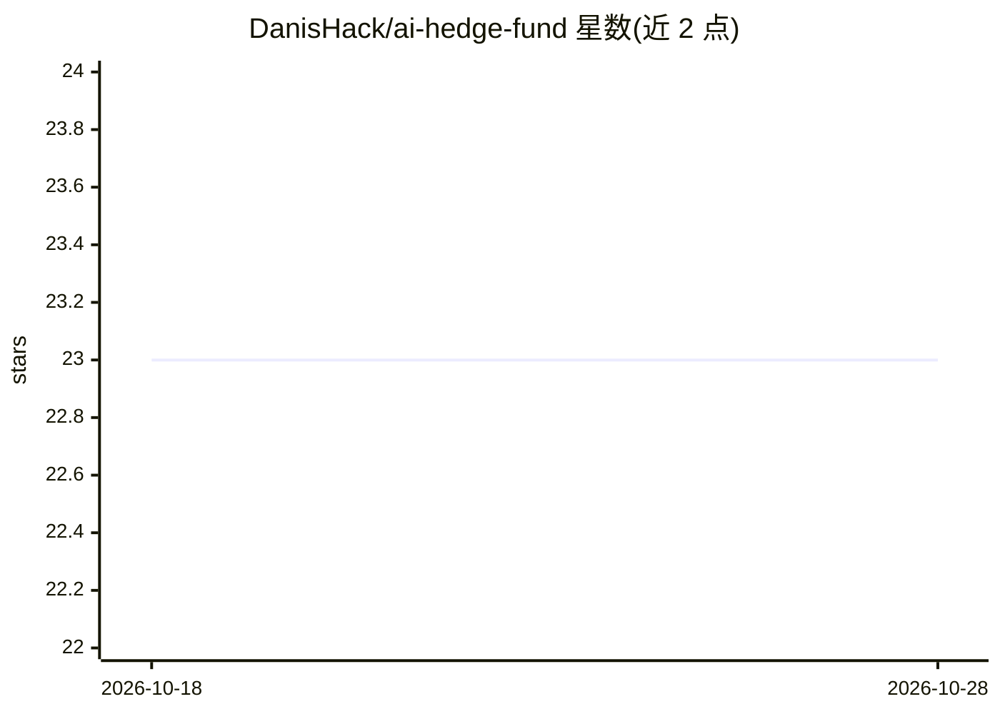

# DanisHack/ai-hedge-fund

⭐ 23 · Python · MIT · 推送 2026-02-13 · [GitHub](https://github.com/DanisHack/ai-hedge-fund) · 个人维护

**多 agent LLM 股票分析与纸面交易系统，供学习研究**

由 6 个分析师 agent（基本面、技术面、情绪、估值、成长、宏观）并行分析股票，经风险管理器过滤后输出买卖持有决策与仓位；可选 12 位投资人 persona（Buffett、Burry 等）用 LLM 推理。默认规则模式无需任何 LLM key，用确定性评分。支持回测（Sharpe、最大回撤等指标）与真实行情数据上的模拟盘交易，含止损/止盈与相关性分组仓位上限。声明仅供教育研究，非投资建议。

## 筛选速览

| 维度 | 判定 | 备注 |
|---|---|---|
| AI 角色 | `ai-native` | 本体是模型或模型工具 |
| 许可风险 | `permissive` | MIT |
| 部署形态 | `library` | 以包/库形式分发 |
| 模型依赖 | — | README 未给出锁定关系 |
| 硬件要求 | — | 无带数字的原话,不猜 |
| 安装摩擦 | `low` | 无编译、无系统依赖或容器化 |
| 成熟度 | — | 结构信号不足 |

## 能力要点

- 6 个分析师 agent 并行分析，默认规则模式无需 LLM key
- 12 位投资人 persona（Buffett/Munger/Burry 等）LLM 推理，5 家 provider 可选
- 回测输出 Sharpe/最大回撤/Calmar 等指标并与 SPY 对比
- 止损/追踪止损/止盈自动风控与相关性感知仓位分组（>0.7 相关组上限 40%）

## 适用场景

- 分析一组股票并得到买卖持有决策与仓位建议
- 在历史数据上回测策略表现
- 用模拟组合在真实行情上跟踪纸面交易

## 场景标签

`金融量化` `多智能体` · 领域:Agent 开发

## 证据(README 行号)

> L3: An AI-powered hedge fund that uses a team of autonomous agents to analyze stocks, manage risk, and make trading deci
> L9: You give it a list of stock tickers. It runs 6 specialized analysts in parallel, filters their signals through a ris
> L61: |`OPENAI_API_KEY`|No|LLM reasoning with `--use-llm` or `--personas`|
> L67: > The system works without any LLM key. The default rule-based mode uses deterministic scoring — no LLM calls, fast

## 星数曲线

2026-10-18 23 → 2026-10-28 23（+0）

---
*卡片 v1 · prompt 1.4 · 生成 2026-10-27 · 置信度 high · 依据 README sha `e3e49eb333c3` · [字段定义](../../DATASET.md)*
