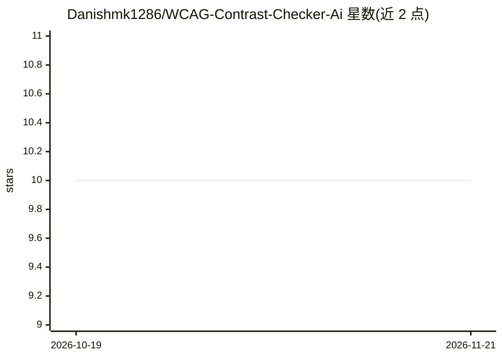

# Danishmk1286/WCAG-Contrast-Checker-Ai

⭐ 10 · TypeScript · MIT · 推送 2026-08-06 · [GitHub](https://github.com/Danishmk1286/WCAG-Contrast-Checker-Ai) · [官网](https://thecolorcontrastchecker.com) · 个人维护

**面向设计师与前端的无障碍配色对比检查器**

基于 React/TypeScript 的颜色对比度检查工具，按 WCAG 2.1/2.2 AA 与 AAA 阈值计算对比度并给出通过/失败判定；当配色不达标时，用 TensorFlow.js 模型生成最小视觉调整建议，按 Delta E (CIEDE2000) 排序并保证给出 5 条通过方案，同时尽量保留品牌色相。核心计算在浏览器本地完成，附带色盲模拟预览与 HEX/RGB/HSL 输入；可选 Node.js/Express 后端仅用于 CMS/博客功能。

## 筛选速览

| 维度 | 判定 | 备注 |
|---|---|---|
| AI 角色 | `ai-enhanced` | 去掉 AI 部分产品仍成立 |
| 许可风险 | `permissive` | MIT |
| 部署形态 | `library` | 以包/库形式分发 |
| 模型依赖 | — | README 未给出锁定关系 |
| 硬件要求 | — | 无带数字的原话,不猜 |
| 安装摩擦 | `low` | 无编译、无系统依赖或容器化 |
| 成熟度 | — | 结构信号不足 |

## 能力要点

- WCAG AA/AAA 验证与实时对比度计算
- TensorFlow.js 生成保持品牌色相的最小调整建议，输出 5 条通过方案
- Delta E (CIEDE2000) 感知排序与三种色盲模拟预览
- 核心对比度计算 100% 客户端运行，不发送数据

## 适用场景

- 检查网页前景/背景色是否达到 WCAG AA/AAA
- 为不达标的品牌色获取最接近的可访问替代色
- 预览配色在色盲用户视角下的呈现

## 场景标签

 · 领域:开发者工具/无障碍设计

## 证据(README 行号)

> L10: > **AI-powered WCAG 2.1 / 2.2 color contrast checker that preserves brand identity while making color combinations 
> L20: Smart Color Contrast Assistant is a **machine-learning powered WCAG contrast checker** built for designers, fronten
> L96: ### 🌐 100% Client-Side (Core Checker)

## 星数曲线

2026-10-19 10 → 2026-11-21 10（+0）

---
*卡片 v1 · prompt 1.4 · 生成 2026-11-20 · 置信度 high · 依据 README sha `032b8c68bfbb` · [字段定义](../../DATASET.md)*
