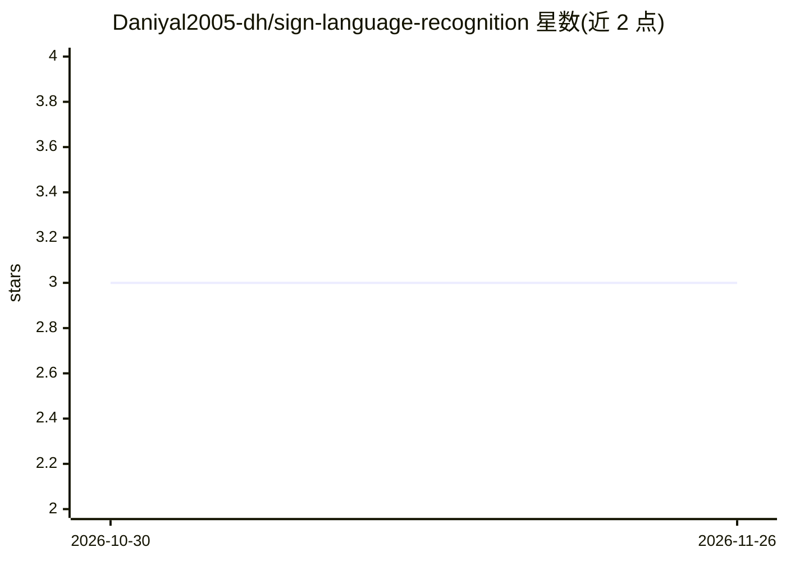

# Daniyal2005-dh/sign-language-recognition

⭐ 3 · Python · MIT · 推送 2026-10-26 · [GitHub](https://github.com/Daniyal2005-dh/sign-language-recognition) · [官网](https://sign-language-rec.streamlit.app/) · 个人维护

**面向手语学习者的实时摄像头手语识别教学原型**

通过 WebRTC 读取浏览器摄像头画面，用 MediaPipe 提取每只手 21 个 3D 关键点，经腕部平移与掌宽缩放归一化为 126 维帧特征，再由预置手姿分类器或自训练的 LSTM/Transformer 识别为词，拼接成可编辑的句子并用 Web Speech API 或 gTTS 朗读。提供 Streamlit 应用、本地桌面演示脚本与数据采集/训练管线，支持按签名者分组评估。README 明确说明这是教育原型，仅识别有限手姿集合，非手语翻译器。

## 筛选速览

| 维度 | 判定 | 备注 |
|---|---|---|
| AI 角色 | `ai-native` | 本体是模型或模型工具 |
| 许可风险 | `permissive` | MIT |
| 部署形态 | `library` | 以包/库形式分发 |
| 模型依赖 | — | README 未给出锁定关系 |
| 硬件要求 | — | 无带数字的原话,不猜 |
| 安装摩擦 | `low` | 无编译、无系统依赖或容器化 |
| 成熟度 | `idea` | |

## 能力要点

- MediaPipe 21 关键点×2 手的 126 帧特征提取与归一化几何
- 预置手姿→演示词映射无需训练即可运行
- 自训练管线含数据采集、混淆矩阵、按签名者分组评估
- Streamlit Community Cloud 免费部署路径与本地桌面演示双入口

## 适用场景

- 体验基于摄像头的手势到语音实时演示
- 采集自己的手语样本训练动态词识别模型
- 按签名者未见数据评估模型泛化能力

## 场景标签

`目标检测` · 领域:感知与多模态

## 证据(README 行号)

> L7: Turn hand signs into words and speech, live from your webcam.
> L22: 4. **Classification** - either pretrained MediaPipe hand-pose categories (works out of the box) **or your own** LST

## 星数曲线

2026-10-30 3 → 2026-11-26 3（+0）

---
*卡片 v1 · prompt 1.4 · 生成 2026-11-22 · 置信度 high · 依据 README sha `acecf70649e1` · [字段定义](../../DATASET.md)*
