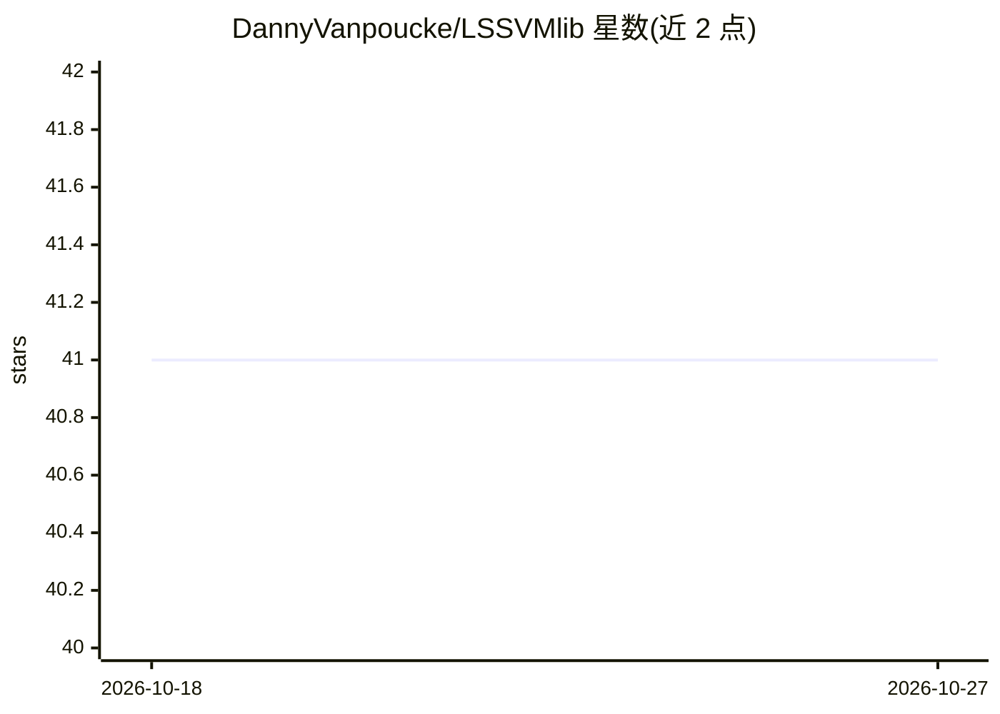

# DannyVanpoucke/LSSVMlib

⭐ 41 · Jupyter Notebook · MIT · 推送 2026-07-21 · [GitHub](https://github.com/DannyVanpoucke/LSSVMlib) · [官网](https://dannyvanpoucke.be/building-scikit-learn-regressor-lssvm-en/) · 个人维护

**LS-SVM 机器学习建模的 Python 库，兼容 scikit-learn API**

提供最小二乘支持向量机（LS-SVM）的 Python 类实现，遵循 scikit-learn API 以便接入 scikit-learn 项目。当前状态为：回归器类已完成，分类类尚未实现。通过 pip 从 GitHub 源码安装，提供 Jupyter/Colab 环境下的安装与卸载命令。开发时基于 Python 3.7.3、scikit-learn 0.21.2、pandas、numpy 与 scipy。

## 筛选速览

| 维度 | 判定 | 备注 |
|---|---|---|
| AI 角色 | `ai-native` | 本体是模型或模型工具 |
| 许可风险 | `permissive` | MIT |
| 部署形态 | `library` | 以包/库形式分发 |
| 模型依赖 | — | README 未给出锁定关系 |
| 硬件要求 | — | 无带数字的原话,不猜 |
| 安装摩擦 | `low` | 无编译、无系统依赖或容器化 |
| 成熟度 | — | 结构信号不足 |

## 能力要点

- LS-SVM 回归器实现（分类类尚未完成）
- 符合 scikit-learn API，可集成到 scikit-learn 工作流
- pip 从 GitHub 直接安装

## 适用场景

- 在 scikit-learn 流程中用 LS-SVM 做回归建模
- 需要 LS-SVM 算法的科研或数据分析项目

## 场景标签

`数据分析` · 领域:效率与自动化

## 证据(README 行号)

> L2: Library of python classes for performing Least-Squares Support Vector Machine (LS-SVM)
> L3: machine-learning modeling. The classes are build to conform to the scikit-learn API allowing for
> L9: - [x] Regressor Class

## 星数曲线

2026-10-18 41 → 2026-10-27 41（+0）

---
*卡片 v1 · prompt 1.4 · 生成 2026-10-25 · 置信度 high · 依据 README sha `5bfe4fb1d8e7` · [字段定义](../../DATASET.md)*
