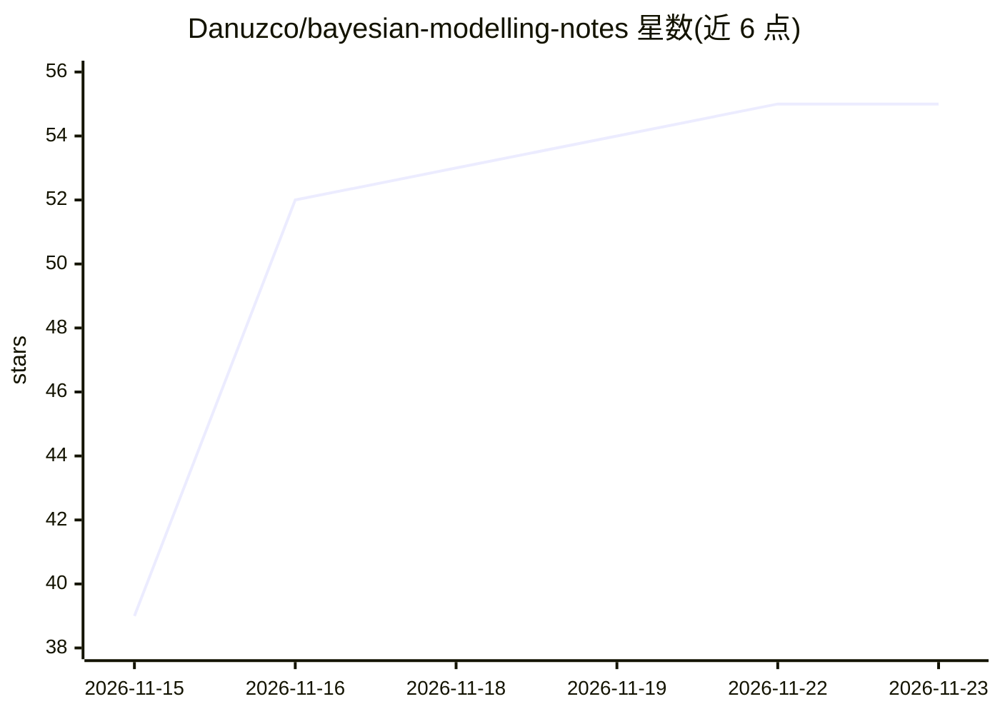

# Danuzco/bayesian-modelling-notes

⭐ 55 · Jupyter Notebook · MIT · 推送 2026-11-22 · [GitHub](https://github.com/Danuzco/bayesian-modelling-notes) · [官网](https://doctoradoia.cl/cuerpo-academico/daniel-uzcategui/) · 个人维护

**智利博士课程的贝叶斯建模讲义与 Jupyter 代码集**

智利人工智能博士项目 Bayesian Modelling 课程的手写讲义（PDF）与 Jupyter notebook 合集，作者为物理学博士 Daniel Uzcategui。内容从集合论、概率论基础讲到共轭模型、卡尔曼滤波、高斯过程、MCMC、变分推断与分层模型，共 10 讲。Notebooks 兼作 JAX 概率推断入门：HMC 与变分推断从零实现（jax.grad/jit/vmap），并用 PyMC 复现同样思路。讲义 CC BY 4.0，代码 MIT，课程仍在进行中，部分页面混有西语。

## 筛选速览

| 维度 | 判定 | 备注 |
|---|---|---|
| AI 角色 | `ai-knowledge` | 知识聚合/清单类 |
| 许可风险 | `permissive` | MIT |
| 部署形态 | `library` | 以包/库形式分发 |
| 模型依赖 | — | README 未给出锁定关系 |
| 硬件要求 | — | 无带数字的原话,不猜 |
| 安装摩擦 | `low` | 无编译、无系统依赖或容器化 |
| 成熟度 | `idea` | |

## 能力要点

- 10 讲课程覆盖概率基础到高斯过程、MCMC、变分推断、分层模型
- HMC 与变分推断在 JAX 中从零实现，不依赖概率编程库
- PyMC 版本模型（NUTS/ADVI、八校分层模型）与理论对照
- notebook 保留输出，可在 GitHub 直接查看结果

## 适用场景

- 系统学习贝叶斯建模与概率机器学习
- 参考 JAX 手写 HMC/变分推断的实现
- 查找共轭模型、卡尔曼滤波、GP 的教学 notebook

## 场景标签

`教程课程` · 领域:学习与行业

## 证据(README 行号)

> L3: **Lecture notes and code for the *Bayesian Modelling* course of the
> L29: The notebooks also work as an **introduction to probabilistic inference in JAX**:

## 星数曲线

2026-11-15 39 → 2026-11-23 55（+16）

---
*卡片 v1 · prompt 1.4 · 生成 2026-11-18 · 置信度 mid · 依据 README sha `e11481b969ea` · [字段定义](../../DATASET.md)*
