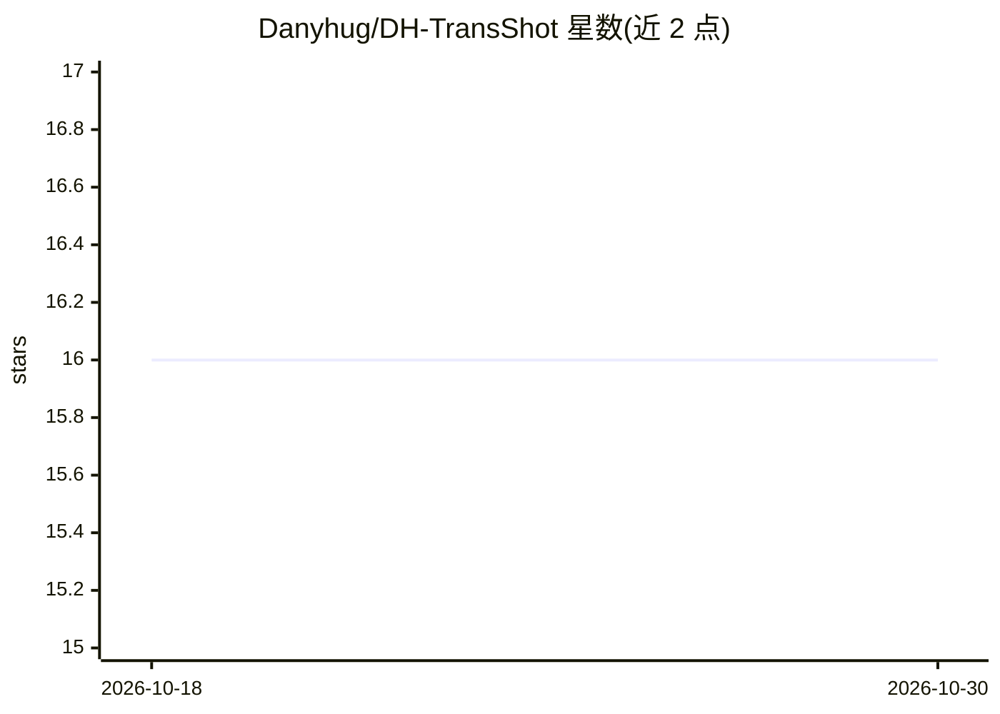

# Danyhug/DH-TransShot

⭐ 16 · Rust · MIT · 推送 2026-10-29 · [GitHub](https://github.com/Danyhug/DH-TransShot) · [官网](https://danyhug.github.io/DH-TransShot/) · 个人维护 · 中文 README

**截屏标注 + OCR 翻译二合一桌面工具（macOS/Windows）**

基于 Rust + Tauri v2 + React 的托盘常驻小工具：快捷键框选屏幕后可标注（矩形/箭头/画笔/马赛克/文字）并复制或保存，也可将框选区域交给视觉模型 OCR 后翻译显示；支持翻译选中文本、翻译剪贴板、原文/译文 TTS 朗读（含音频缓存与流式播放）。翻译、OCR、TTS 三条链路均走 OpenAI 兼容接口，可各自配置不同提供商，默认指向 SiliconFlow 的模型。支持 15 种目标语言、全局凭据回退与多提供商覆盖、快捷键自定义。macOS 提供 .dmg、Windows 提供 .msi，也可用 pnpm + Tauri 从源码构建；macOS 需授权屏幕录制与辅助功能权限。

## 筛选速览

| 维度 | 判定 | 备注 |
|---|---|---|
| AI 角色 | `ai-enhanced` | 去掉 AI 部分产品仍成立 |
| 许可风险 | `permissive` | MIT |
| 部署形态 | `desktop` | 安装包/桌面程序 |
| 模型依赖 | — | README 未给出锁定关系 |
| 硬件要求 | — | 无带数字的原话,不猜 |
| 安装摩擦 | `low` | 无编译、无系统依赖或容器化 |
| 成熟度 | — | 结构信号不足 |

## 能力要点

- 区域截图 → 视觉模型 OCR → 翻译一步完成，支持 15 种目标语言
- 翻译/OCR/TTS 三链路各自接入任意 OpenAI 兼容服务（含 Ollama、DeepSeek、小米 MiMo）
- 五种标注工具（矩形/箭头/画笔/马赛克/文字）与取色器
- TTS 双协议支持（audio/speech 与 chat+audio 流式）及音频缓存

## 适用场景

- 快捷键截屏后直接标注并复制到剪贴板
- 框选屏幕文字让视觉模型识别并翻译成目标语言
- 翻译当前选中文本或剪贴板内容，并可朗读原文与译文

## 场景标签

`OCR` `语音合成` · 领域:内容生成

## 证据(README 行号)

> L13: 一个常驻托盘的小窗口：按下快捷键框选屏幕，截图直接进剪贴板；或者让视觉模型读出框选区域里的文字，翻译好再显示出来。翻译、OCR、TTS 三条链路都走 OpenAI 兼容接口，可以各自接不同的服务商。
> L41: - **区域截图** — 快捷键框选屏幕区域，自动裁切并复制到剪贴板

## 星数曲线

2026-10-18 16 → 2026-10-30 16（+0）

---
*卡片 v1 · prompt 1.4 · 生成 2026-10-30 · 置信度 high · 依据 README sha `6807fb378783` · [字段定义](../../DATASET.md)*
