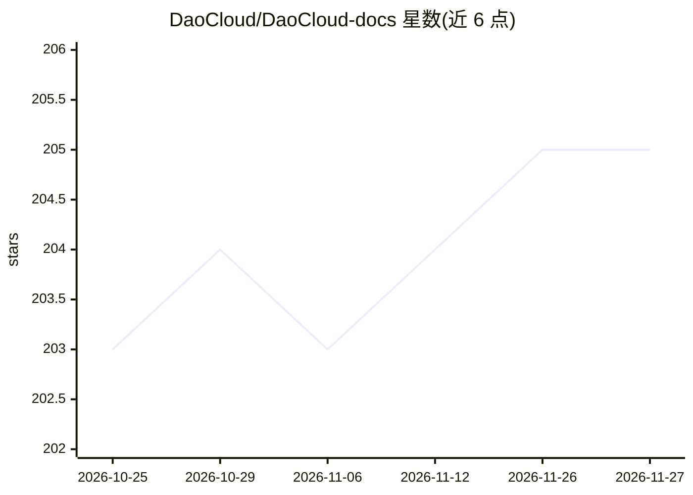

# DaoCloud/DaoCloud-docs

⭐ 205 · Python · Apache-2.0 · 推送 2026-11-26 · [GitHub](https://github.com/DaoCloud/DaoCloud-docs) · [官网](https://docs.daocloud.io) · 组织维护 · 中文 README

**DaoCloud 云原生与 AI 服务官方文档站仓库**

DaoCloud 的文档仓库，内容覆盖其 Kubernetes 与 AI 服务的使用文档，站点基于 MkDocs 构建，页面均为 Markdown。工作流采用 GitOps：贡献者通过 Fork、本地编辑、PR 修改与翻译页面，可经 Docker（make serve-docker）或 uv 依赖方式在本地预览中英文站点。仓库另含文件命名规范、写作规范及样式指南。

## 筛选速览

| 维度 | 判定 | 备注 |
|---|---|---|
| AI 角色 | `ai-knowledge` | 知识聚合/清单类 |
| 许可风险 | `permissive` | Apache-2.0 |
| 部署形态 | `None` |  |
| 模型依赖 | — | README 未给出锁定关系 |
| 硬件要求 | — | 无带数字的原话,不猜 |
| 安装摩擦 | `low` | 无编译、无系统依赖或容器化 |
| 成熟度 | — | 结构信号不足 |

## 能力要点

- 中英双语文档站点，基于 MkDocs 与 GitOps 工作流
- Docker 或 uv 两种本地预览方式（make serve zh/en）
- 覆盖多个 CNCF 一致性认证的 Kubernetes 版本文档
- 包含命名规范与写作风格指南等贡献规范

## 适用场景

- 为 DaoCloud 文档提交修改或翻译的 PR
- 在本地预览文档站点改动
- 查阅 DaoCloud 支持的 Kubernetes 版本信息

## 场景标签

 · 领域:云原生/开发者文档

## 证据(README 行号)

> L8: DaoCloud is a certified Kubernetes and AI service provider.
> L42: > This website is created with MkDocs. All pages are written in markdown. We use GitOps to control workflow and ver
> L70: 3. Preview Chinese docs: `make serve zh`

## 星数曲线

2026-10-25 203 → 2026-11-27 205（+2）

---
*卡片 v1 · prompt 1.4 · 生成 2026-11-25 · 置信度 mid · 依据 README sha `b377471cdfab` · [字段定义](../../DATASET.md)*
