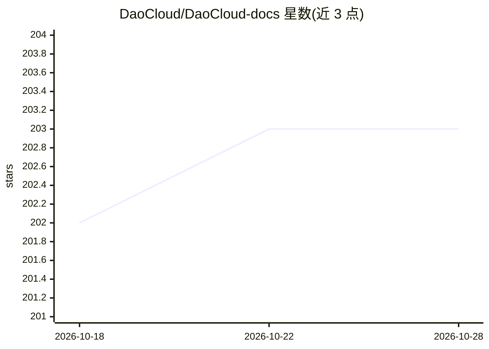

# DaoCloud/DaoCloud-docs

⭐ 203 · Python · Apache-2.0 · 推送 2026-10-27 · [GitHub](https://github.com/DaoCloud/DaoCloud-docs) · [官网](https://docs.daocloud.io) · 组织维护 · 中文 README

**DaoCloud 的云原生与 Kubernetes 产品文档中心（中英双语）**

由 DaoCloud 公司维护的产品文档仓库，使用 MkDocs 构建，全部页面以 Markdown 编写，通过 GitOps 控制工作流与版本，提供中文与英文双语站点。README 主要面向文档贡献者：说明 Fork/PR 贡献流程、Docker 与 Git 两种本地预览方式（make serve-docker / uv sync + make serve）、文件命名规范与写作规范。产品线通过 CNCF 及 CNCF AI Conformance 认证，覆盖 Kubernetes 1.7–1.36 多个版本，旧版本由 KLTS 继续维护。

## 筛选速览

| 维度 | 判定 | 备注 |
|---|---|---|
| AI 角色 | `ai-knowledge` | 知识聚合/清单类 |
| 许可风险 | `permissive` | Apache-2.0 |
| 部署形态 | `None` |  |
| 模型依赖 | — | README 未给出锁定关系 |
| 硬件要求 | — | 无带数字的原话,不猜 |
| 安装摩擦 | `low` | 无编译、无系统依赖或容器化 |
| 成熟度 | — | 结构信号不足 |

## 能力要点

- MkDocs + Markdown + GitOps 的双语文档站
- 通过 CNCF 与 CNCF AI Conformance 认证，覆盖 K8s 1.7–1.36
- Docker 与本地 Git 两种文档预览/构建方式
- 明确的文件命名规范与写作规范供贡献者遵循

## 适用场景

- 查阅 DaoCloud 云原生与 AI 产品的使用文档
- 通过 PR 参与文档的修改与翻译
- 本地构建预览文档站点进行校对

## 场景标签

 · 领域:云原生/文档

## 证据(README 行号)

> L41: > This website is created with MkDocs. All pages are written in markdown. We use GitOps to control workflow and ver
> L8: DaoCloud is a certified Kubernetes and AI service provider.

## 星数曲线

2026-10-18 202 → 2026-10-28 203（+1）

---
*卡片 v1 · prompt 1.4 · 生成 2026-10-22 · 置信度 mid · 依据 README sha `3559ecaee2b7` · [字段定义](../../DATASET.md)*
