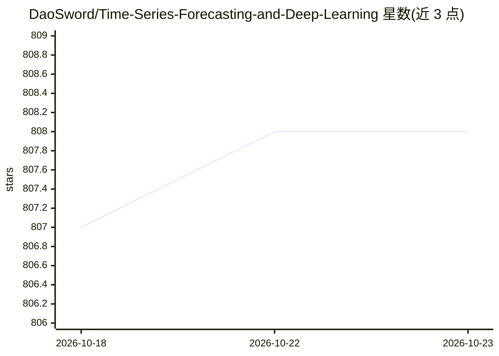

# DaoSword/Time-Series-Forecasting-and-Deep-Learning

⭐ 808 · Python · 推送 2026-10-19 · [GitHub](https://github.com/DaoSword/Time-Series-Forecasting-and-Deep-Learning) · 个人维护

**时间序列预测与深度学习研究论文及资源清单**

收录时间序列预测与深度学习方向研究论文的策展清单，共 645 篇，按年份（2017-2026）组织，条目含论文标题、作者与官方代码链接。范围覆盖预测及相邻任务：异常检测、分类、插补、生成与表示学习。另包含应用、基准（FinTSB、GIFT-Eval、TIME、QuitoBench）等类别资源，以及竞赛、数据集、课程、博客与代码等（见目录声明）。面向该方向的研究者与开发者做文献与代码检索。

## 筛选速览

| 维度 | 判定 | 备注 |
|---|---|---|
| AI 角色 | `ai-knowledge` | 知识聚合/清单类 |
| 许可风险 | `none` | — |
| 部署形态 | `None` |  |
| 模型依赖 | — | README 未给出锁定关系 |
| 硬件要求 | — | 无带数字的原话,不猜 |
| 安装摩擦 | `low` | 无编译、无系统依赖或容器化 |
| 成熟度 | — | 结构信号不足 |

## 能力要点

- 645 篇论文按年份组织，附官方代码链接
- 覆盖预测之外的异常检测/分类/插补/生成/表示学习任务
- 收录 FinTSB、GIFT-Eval、TIME、QuitoBench 等基准与 TimeGPT 应用

## 适用场景

- 查找时间序列预测方向的最新论文与官方实现
- 选择时间序列预测评测基准
- 了解相邻任务（异常检测、插补等）的研究进展

## 场景标签

`精选清单` · 领域:学习与行业

## 证据(README 行号)

> L9: List of research papers focus on time series forecasting and deep learning, as well as other resources like competit
> L15: This collection primarily focuses on time series forecasting. It also covers adjacent time series tasks, including 

## 星数曲线

2026-10-18 807 → 2026-10-23 808（+1）

---
*卡片 v1 · prompt 1.4 · 生成 2026-10-21 · 置信度 high · 依据 README sha `c4424c61f265` · [字段定义](../../DATASET.md)*
