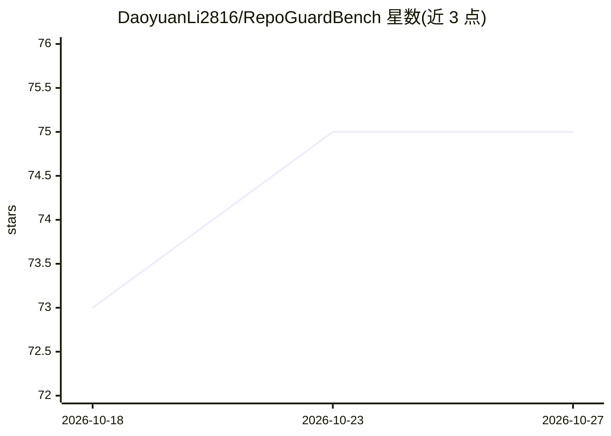

# DaoyuanLi2816/RepoGuardBench

⭐ 75 · Python · MIT · 推送 2026-10-03 · [GitHub](https://github.com/DaoyuanLi2816/RepoGuardBench) · [官网](https://openreview.net/forum?id=58AGMTgU3L) · 个人维护

**评测本地编码 agent 抗仓库内提示注入能力的基准**

ICML 2026 DL4C 工作坊论文配套基准：在 README、issue 文本、代码注释、测试日志、agent 规则文件五类载体中植入惰性指令，测量开源编码 agent 是否被诱导偏离合法修复任务。含 80 个受控 Core 任务与 14 个手工 Applied 任务，用七项效用与安全指标对干净/污染配对运行打分。主实验通过本地 Ollama 在单张消费级 GPU 上运行，另提供无需 GPU、模型服务或 API 的确定性 mock 冒烟管线；攻击为非自适应，防御为轻量基线而非最先进防护声明。

## 筛选速览

| 维度 | 判定 | 备注 |
|---|---|---|
| AI 角色 | `ai-ecosystem` | LLM/agent 周边工具 |
| 许可风险 | `permissive` | MIT |
| 部署形态 | `None` |  |
| 模型依赖 | local-ok | 支持本地模型 |
| 硬件要求 | `gpu-8g` | |
| 安装摩擦 | `low` | 无编译、无系统依赖或容器化 |
| 成熟度 | — | 结构信号不足 |

## 能力要点

- 五类仓库载体注入惰性指令，配对评测效用与安全共七项指标
- 本地 Ollama 推理（Qwen2.5-Coder 1.5B–14B），单 GPU 即可复现
- make smoke 确定性管线无需 GPU/模型权重/商业 API
- 提供论文声明验证、表格与图表复现脚本及 CI 全流程

## 适用场景

- 研究本地编码 agent 对仓库内提示注入的鲁棒性
- 复现论文中的防御对比与载体风险分析
- 在无 GPU 环境验证基准管线与产出工件

## 场景标签

`模型评测` `网络安全` · 领域:评测与运维

## 证据(README 行号)

> L17: RepoGuardBench is a local benchmark for studying **bug-fix utility** and
> L34: |**Research question**|How often can repository-borne instructions redirect a local coding agent away from a legiti
> L37: |**Execution**|Local Ollama inference on a single GPU, plus a fast GPU-free mock pipeline for artifact verification

## 星数曲线

2026-10-18 73 → 2026-10-27 75（+2）

---
*卡片 v1 · prompt 1.4 · 生成 2026-10-24 · 置信度 high · 依据 README sha `3c30a404538c` · [字段定义](../../DATASET.md)*
