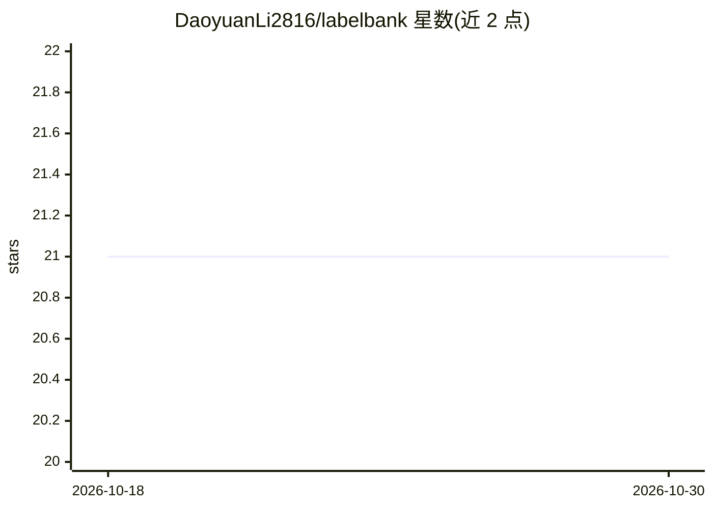

# DaoyuanLi2816/labelbank

⭐ 21 · Python · MIT · 推送 2026-07-11 · [GitHub](https://github.com/DaoyuanLi2816/labelbank) · [官网](https://pypi.org/project/labelbank/) · 个人维护

**闭集标签库检索+重排库：自挖难负例训练双编码器与列表式重排器**

从 Kaggle Eedi 数学误解挖掘银牌方案泛化出的 Python 库，解决『给定自由文本在固定标签目录中找匹配项』的问题。两阶段流水线：LoRA 微调的 LLM 双编码器做检索，训练时用自挖的难负例池（模型自身 top-k 作为下轮负例，禁用 in-batch 负例）；再由生成式列表重排器（字母选项、位置打乱、completion-only SFT）重排 top-k。支持任意 Hugging Face backbone，golden tests 将默认行为锁定为与获奖代码逐字节一致。提供 pypi 多 extras 安装与 YAML 驱动的完整训练循环。

## 筛选速览

| 维度 | 判定 | 备注 |
|---|---|---|
| AI 角色 | `ai-native` | 本体是模型或模型工具 |
| 许可风险 | `permissive` | MIT |
| 部署形态 | `library` | 以包/库形式分发 |
| 模型依赖 | — | README 未给出锁定关系 |
| 硬件要求 | — | 无带数字的原话,不猜 |
| 安装摩擦 | `low` | 无编译、无系统依赖或容器化 |
| 成熟度 | — | 结构信号不足 |

## 能力要点

- 自挖难负例循环：每轮用当前模型在全库上的排序构造 gold-first 负例池
- 生成式列表重排器：训练时打乱正确项位置，推理用字母 next-token logits 重排
- 支持任意 HF causal 模型作 bi-encoder（last-token pooling、LoRA、4-bit）
- golden tests 断言与获奖竞赛代码输出逐字节一致

## 适用场景

- 工单/错误日志映射到已知问题或根因目录
- 症状映射到诊断码、内容映射到政策类别
- 学生错误映射到细粒度误解体系等细粒度闭集标签匹配

## 场景标签

`语义搜索` · 领域:知识与检索

## 证据(README 行号)

> L9: `labelbank` is the generalized core of a **silver-medal (top 5%) solution** to Kaggle's Eedi — Mining Misconceptions
> L111: ||sentence-transformers / BGE|RAG over a corpus|`labelbank`|

## 星数曲线

2026-10-18 21 → 2026-10-30 21（+0）

---
*卡片 v1 · prompt 1.4 · 生成 2026-10-28 · 置信度 high · 依据 README sha `415146481708` · [字段定义](../../DATASET.md)*
