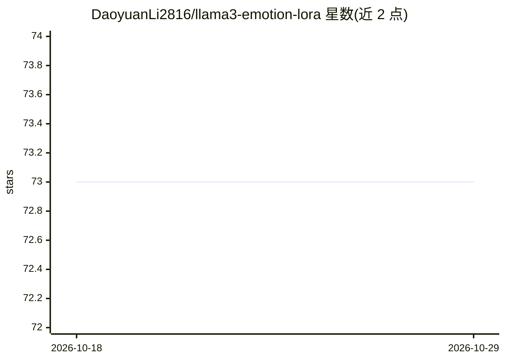

# DaoyuanLi2816/llama3-emotion-lora

⭐ 73 · Python · Apache-2.0 · 推送 2026-07-11 · [GitHub](https://github.com/DaoyuanLi2816/llama3-emotion-lora) · 个人维护

**Llama3-8B+LoRA 六类情感文本分类复现项目**

基于 LLaMA-Factory（pip 依赖）的复现工程：用 LoRA（rank 8）与 FlashAttention-2 对 Meta-Llama-3-8B-Instruct 做监督微调，完成 joy/sadness/anger/fear/love/surprise 六类情感分类，在 2,000 条测试集上报告 92.62% 准确率，并与 BERT/RoBERTa 基线对比。仓库本身只含数据集（16,000/2,000 条指令式记录）、训练与预测 YAML 配置及评估脚本，训练推理全部通过 llamafactory-cli 驱动；fp16 运行需约 24GB GPU，16GB 显卡可加 4bit 量化。

## 筛选速览

| 维度 | 判定 | 备注 |
|---|---|---|
| AI 角色 | `ai-native` | 本体是模型或模型工具 |
| 许可风险 | `permissive` | Apache-2.0 |
| 部署形态 | `library` | 以包/库形式分发 |
| 模型依赖 | — | README 未给出锁定关系 |
| 硬件要求 | — | 无带数字的原话,不猜 |
| 安装摩擦 | `high` | 编译与系统依赖俱全 |
| 成熟度 | — | 结构信号不足 |

## 能力要点

- 仓库提供数据集、LLaMA-Factory YAML 配置与评估脚本，端到端复现训练与推理
- LoRA（rank 8）+ FlashAttention-2 微调 Meta-Llama-3-8B-Instruct
- 评估脚本输出总体与逐类准确率，覆盖类别不均衡问题
- fp16 适配 24GB GPU；16GB 显卡可用 4bit 量化（QLoRA）

## 适用场景

- 我需要复现一个 LLM 情感分类实验的完整流程
- 我想学习如何用 LLaMA-Factory 做 LoRA 微调与预测
- 我需要六类情感指令式数据集与逐类评估脚本

## 场景标签

`微调` · 领域:训练与推理

## 证据(README 行号)

> L14: Concretely, this repository is the LLaMA-Factory YAML configs, dataset, and evaluation script needed to reproduce t
> L22: - **Model**: `meta-llama/Meta-Llama-3-8B-Instruct`, fine-tuned via supervised LoRA fine-tuning (SFT).
> L25: - **Performance**: 92.62% accuracy, surpassing BERT and RoBERTa baselines (Table 3).

## 星数曲线

2026-10-18 73 → 2026-10-29 73（+0）

---
*卡片 v1 · prompt 1.4 · 生成 2026-10-24 · 置信度 high · 依据 README sha `d76e2f025753` · [字段定义](../../DATASET.md)*
