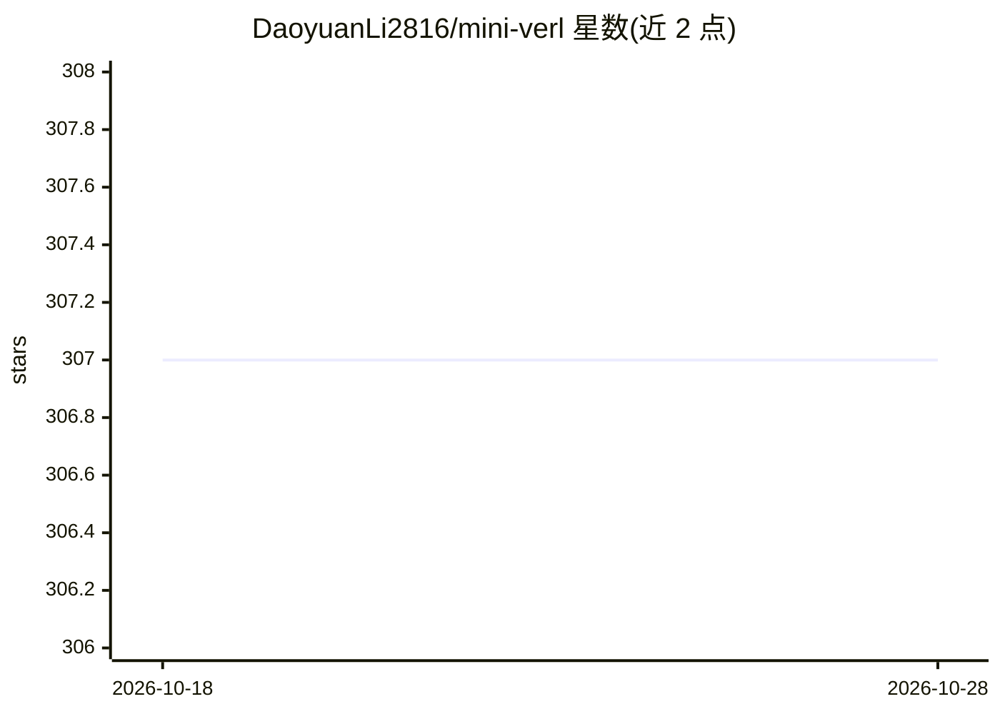

# DaoyuanLi2816/mini-verl

⭐ 307 · Python · Apache-2.0 · 推送 2026-09-15 · [GitHub](https://github.com/DaoyuanLi2816/mini-verl) · [官网](https://pypi.org/project/miniverl/) · 个人维护 · 中文 README

**单张消费级 GPU 上运行 verl 风格 RL 训练的框架**

面向单张 NVIDIA 消费级 GPU 的 LLM 后训练框架，兼容 verl 的配置体系：可迁移已有 verl 配置树与 Hydra overrides，在本地运行 PPO、GRPO、on-policy 蒸馏（OPD），也提供 SFT、DPO、离线 KD 的原生 recipe。单卡上按阶段串行执行 rollout、reward、reference、teacher 与 update，各角色共享 GPU；支持从 checkpoint 精确恢复（模型/优化器/数据位置/随机状态），并可导出 adapter、数据集与配置。以 PyPI 包（v0.16.0 稳定）提供，Apache-2.0 许可。限制：仅支持 NVIDIA CUDA，模型适配取决于显存与负载，有分布式执行边界限制。

## 筛选速览

| 维度 | 判定 | 备注 |
|---|---|---|
| AI 角色 | `ai-ecosystem` | LLM/agent 周边工具 |
| 许可风险 | `permissive` | Apache-2.0 |
| 部署形态 | `library` | 以包/库形式分发 |
| 模型依赖 | — | README 未给出锁定关系 |
| 硬件要求 | — | 无带数字的原话,不猜 |
| 安装摩擦 | `medium` | 含编译或系统依赖之一 |
| 成熟度 | — | 结构信号不足 |

## 能力要点

- 兼容 verl 配置树与 Hydra overrides 的本地运行
- PPO/GRPO/on-policy 蒸馏及 SFT、DPO、离线 KD recipe
- checkpoint 精确恢复（字节级一致，实测 RTX 4080 验证）
- 消费级显存实测：Qwen3-0.6B/1.7B OPD 峰值约 3.19 GiB

## 适用场景

- 在单张消费级 GPU 上本地做 PPO/GRPO 对齐训练
- 把已有 verl 实验配置迁移到本地小规模复现
- 用教师模型对学生自身 rollout 做 on-policy 蒸馏

## 场景标签

`强化学习` `微调` · 领域:训练与推理

## 证据(README 行号)

> L16: Run PPO, GRPO and on-policy distillation on one NVIDIA GPU. Bring your verl
> L62: - **Familiar configs.** Reuse verl fields and overrides; inspect how each maps to local execution.

## 星数曲线

2026-10-18 307 → 2026-10-28 307（+0）

---
*卡片 v1 · prompt 1.4 · 生成 2026-10-22 · 置信度 high · 依据 README sha `270d2cf6dd31` · [字段定义](../../DATASET.md)*
