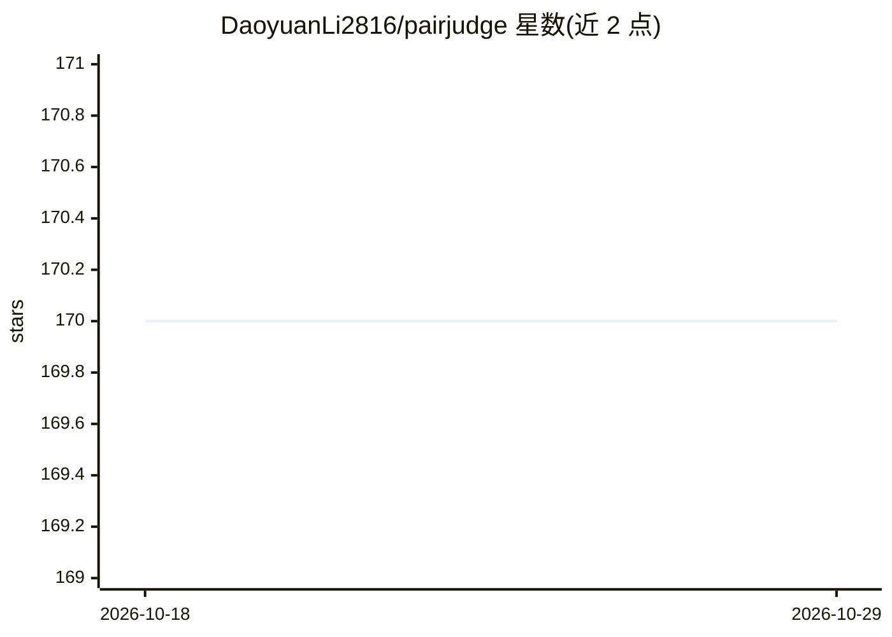

# DaoyuanLi2816/pairjudge

⭐ 170 · Python · MIT · 推送 2026-10-09 · [GitHub](https://github.com/DaoyuanLi2816/pairjudge) · [官网](https://pypi.org/project/pairjudge/) · 个人维护

**成对偏好评判库：判定 A 胜/B 胜/平局并做位置偏差校正**

Python 库与 CLI，输入一个 prompt 与两个回答，输出 A/B/tie 三类概率、判定与内容保留诊断。方法源自 Kaggle LMSYS Chatbot Arena 第 4 名（金牌）方案，提供预算感知的多轮打包（balanced_v2）、双向打分取平均的位置偏差校正、三分类训练与伪标签蒸馏。内置 0.5B 示例模型（基于 Qwen2.5-0.5B-Instruct 微调），首次推理约下载 2GB 权重，支持 CPU/CUDA。概率未校准，tie 召回低，作者声明不适用于高风险决策。

## 筛选速览

| 维度 | 判定 | 备注 |
|---|---|---|
| AI 角色 | `ai-native` | 本体是模型或模型工具 |
| 许可风险 | `permissive` | MIT |
| 部署形态 | `library` | 以包/库形式分发 |
| 模型依赖 | — | README 未给出锁定关系 |
| 硬件要求 | — | 无带数字的原话,不猜 |
| 安装摩擦 | `medium` | 含编译或系统依赖之一 |
| 成熟度 | — | 结构信号不足 |

## 能力要点

- A/B/tie 三类概率输出与内容保留诊断
- 双向交换取平均的 swap-equivariant 概率
- 预算感知多轮打包 balanced_v2，截断显式可查
- 三分类训练（CE+KL）与伪标签蒸馏流水线

## 适用场景

- 评估两个模型对同一提问回答的相对优劣
- 本地批量跑偏好对比实验并查看位置偏差诊断
- 在自己的偏好数据上训练定制评判模型

## 场景标签

`模型评测` `微调` · 领域:评测与运维

## 证据(README 行号)

> L9: `pairjudge` compares a prompt and two responses, returning **A wins / B wins / tie** probabilities, retained-content
> L50: ## What the library provides
> L93: The public example fine-tunes Apache-2.0 Qwen2.5-0.5B-Instruct on Apache-2.0 Arena human preferences, using frozen 

## 星数曲线

2026-10-18 170 → 2026-10-29 170（+0）

---
*卡片 v1 · prompt 1.4 · 生成 2026-10-23 · 置信度 high · 依据 README sha `588d2f6eb094` · [字段定义](../../DATASET.md)*
