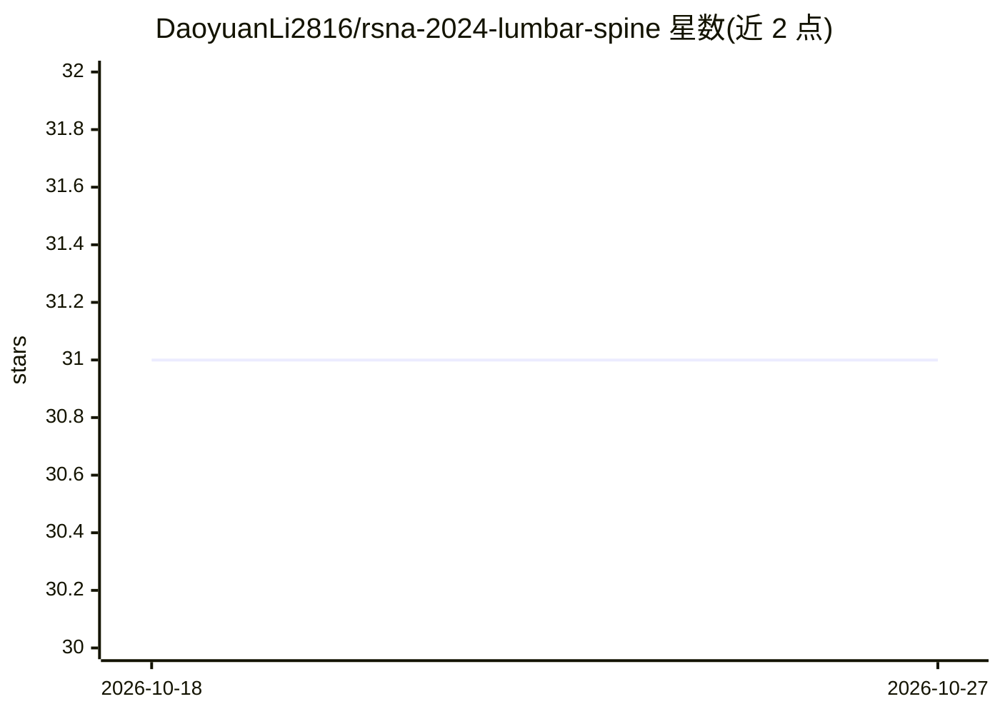

# DaoyuanLi2816/rsna-2024-lumbar-spine

⭐ 31 · Jupyter Notebook · MIT · 推送 2026-07-11 · [GitHub](https://github.com/DaoyuanLi2816/rsna-2024-lumbar-spine) · [官网](https://www.kaggle.com/competitions/rsna-2024-lumbar-spine-degenerative-classification) · 个人维护

**Kaggle RSNA 2024 腰椎退变分类银牌方案：YOLOv8 检测分级**

面向 Kaggle RSNA 2024 腰椎退行性分类竞赛的解决方案代码库：对 MRI 腰椎影像检测并分级五种退变疾病（神经孔狭窄、椎管狭窄、软骨下狭窄）的严重程度。机制为每种疾病训练一个 YOLOv8 模型，边界框类别联合编码椎间盘层面与严重度，共 75 个类别，推理时按 condition_level_severity 聚合取最大值并归一化为概率。含 DICOM 转 YOLO 格式的预处理流程与 5 折交叉验证训练。以 Jupyter notebook 组织代码，路径需按本机环境修改；在 1,874 队中排第 67 名获银牌。

## 筛选速览

| 维度 | 判定 | 备注 |
|---|---|---|
| AI 角色 | `ai-native` | 本体是模型或模型工具 |
| 许可风险 | `permissive` | MIT |
| 部署形态 | `library` | 以包/库形式分发 |
| 模型依赖 | — | README 未给出锁定关系 |
| 硬件要求 | — | 无带数字的原话,不猜 |
| 安装摩擦 | `low` | 无编译、无系统依赖或容器化 |
| 成熟度 | — | 结构信号不足 |

## 能力要点

- 每种退变疾病训练独立 YOLOv8 模型，5 折交叉验证
- 边界框类别联合编码椎间盘层面与严重度，共 75 类
- DICOM 影像读取、标准化与 YOLO 格式转换的预处理流程
- 多 MRI 序列（矢状 T1/T2、轴位 T2）分别对应不同模型推理

## 适用场景

- 复现或学习 RSNA 2024 腰椎退变分类的银牌方案
- 参考医学影像多疾病检测与严重度分级的多模型设计
- 复用 DICOM 转 YOLO 数据集构建流程做类似任务

## 场景标签

`目标检测` · 领域:感知与多模态

## 证据(README 行号)

> L8: This solution was developed for the RSNA 2024 Lumbar Spine Degenerative Classification competition on Kaggle, where 
> L76: Our solution builds a multi-model approach with **YOLOv8** — one model per degenerative condition (NFN, SCS, SS) — 

## 星数曲线

2026-10-18 31 → 2026-10-27 31（+0）

---
*卡片 v1 · prompt 1.4 · 生成 2026-10-26 · 置信度 mid · 依据 README sha `f275de450302` · [字段定义](../../DATASET.md)*
