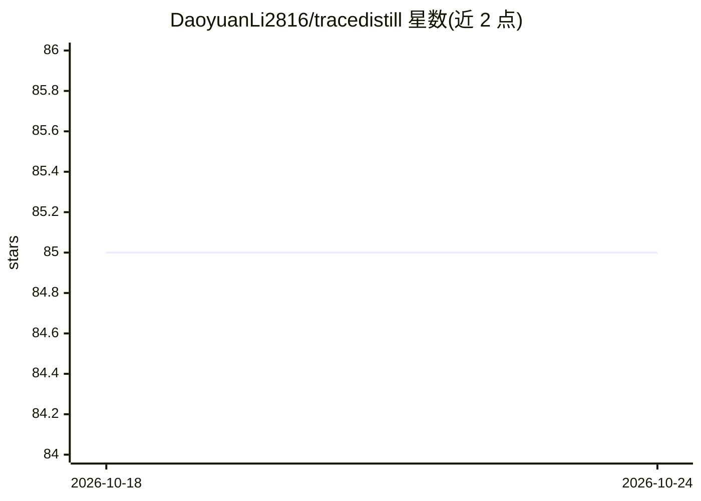

# DaoyuanLi2816/tracedistill

⭐ 85 · Python · MIT · 推送 2026-07-27 · [GitHub](https://github.com/DaoyuanLi2816/tracedistill) · 个人维护

**把教师思维链蒸馏成 LoRA 适配器的两阶段训练库**

从 NVIDIA Nemotron Model Reasoning Challenge 银牌方案（65/4182）中抽取的通用训练库：给定 (问题, 教师思维链, 答案) 三元组，训练能在思维链内自行推导并以 \boxed{} 输出可解析答案的 LoRA 适配器。关键机制：严格的 <think>…</think>\boxed{} 格式契约、两阶段 Train→Nudge 训练、类型分层批次、面向 Mamba-2+MoE 混合架构的 LoRA 目标。核心部分无需 torch，训练需另装 [train] 依赖，附 CLI 与竞赛原始代码。

## 筛选速览

| 维度 | 判定 | 备注 |
|---|---|---|
| AI 角色 | `ai-ecosystem` | LLM/agent 周边工具 |
| 许可风险 | `permissive` | MIT |
| 部署形态 | `library` | 以包/库形式分发 |
| 模型依赖 | — | README 未给出锁定关系 |
| 硬件要求 | — | 无带数字的原话,不猜 |
| 安装摩擦 | `low` | 无编译、无系统依赖或容器化 |
| 成熟度 | — | 结构信号不足 |

## 能力要点

- 严格格式契约：训练目标与评测协议逐字节一致，答案与推理解耦
- 两阶段 Train→Nudge 训练：高学习率主训 + 低学习率续训防遗忘
- 类型分层 round-robin 批次保持有效批次均衡
- 架构感知 LoRA：覆盖 Mamba-2 SSM 的 in_proj/out_proj、attention 与 MLP

## 适用场景

- 把教师模型的思维链蒸馏进小模型的 LoRA 适配器
- 为无法运行代码的评测任务训练自行推理并输出 \boxed{} 的模型
- 复现或改造 NVIDIA Nemotron 银牌训练方案

## 场景标签

`微调` · 领域:训练与推理

## 证据(README 行号)

> L19: Give it `(problem, teacher chain-of-thought, answer)` triples and it trains a LoRA adapter
> L33: 2. **Two-phase `Train → Nudge`** (`training.py`). A hard,
> L40: 4. **Architecture-aware LoRA** (`lora.py`). The competition base

## 星数曲线

2026-10-18 85 → 2026-10-24 85（+0）

---
*卡片 v1 · prompt 1.4 · 生成 2026-10-24 · 置信度 high · 依据 README sha `794754a565a6` · [字段定义](../../DATASET.md)*
