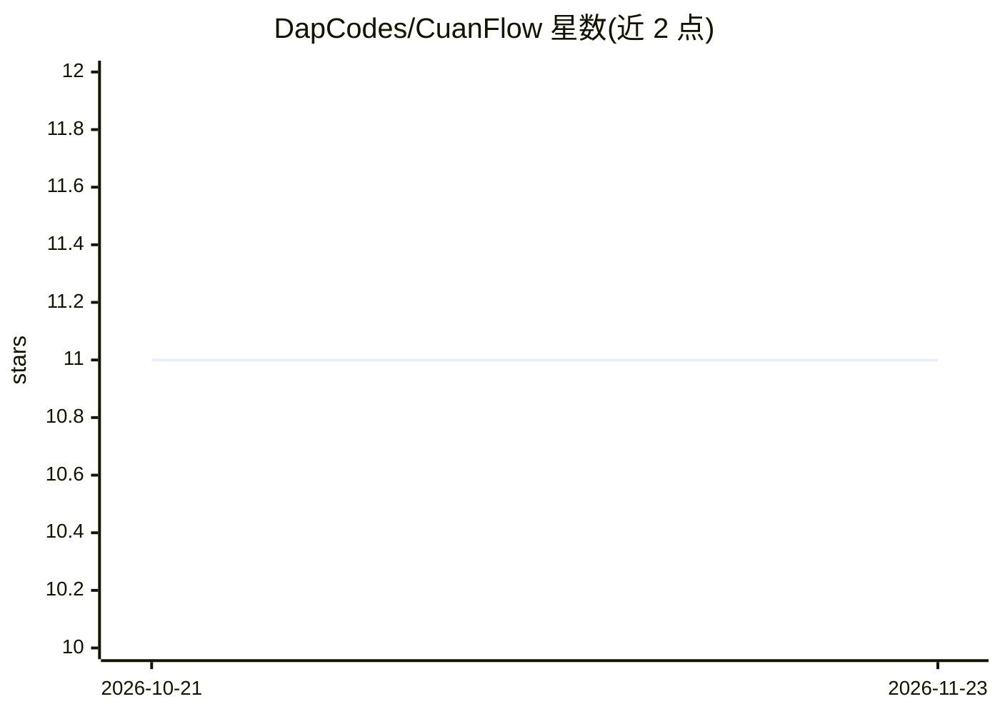

# DapCodes/CuanFlow

⭐ 11 · Blade · NOASSERTION · 推送 2026-04-18 · [GitHub](https://github.com/DapCodes/CuanFlow) · 个人维护

**面向中小企业的开源 POS 与业务管理系统，带 AI 洞察**

基于 Laravel 12 构建的收银与业务管理系统，覆盖快速结账、多种支付（现金/转账/Midtrans）、折扣与优惠券、库存与原料管理、成本自动核算、配方扣料、收支记录、销售图表与 Excel/PDF 报表导出。AI 部分：Gemini API 驱动的配方生成建议、自动业务分析与建议、Clara AI 聊天助手用于查询经营表现与导航系统。安装需 PHP 8.2+、Composer、Node.js 与 MySQL。

## 筛选速览

| 维度 | 判定 | 备注 |
|---|---|---|
| AI 角色 | `ai-enhanced` | 去掉 AI 部分产品仍成立 |
| 许可风险 | `none` | NOASSERTION |
| 部署形态 | `library` | 以包/库形式分发 |
| 模型依赖 | — | README 未给出锁定关系 |
| 硬件要求 | — | 无带数字的原话,不猜 |
| 安装摩擦 | `low` | 无编译、无系统依赖或容器化 |
| 成熟度 | — | 结构信号不足 |

## 能力要点

- 收银/库存/生产/财务报表一体化的 POS 系统
- Gemini API 驱动：配方生成、业务洞察与 Clara AI 助手
- Midtrans 在线支付集成（印尼市场）
- Leaflet 地图销售点轨迹展示与备份、角色权限管理

## 适用场景

- 给中小型餐饮/零售店管理收银与库存
- 自动核算产品成本并在生产时扣减原料
- 通过 AI 助手查询销售表现并获取经营建议
- 在地图上查看交易分布情况

## 场景标签

`AI 助手` `数据分析` · 领域:效率与自动化

## 证据(README 行号)

> L7: **CuanFlow** is a modern, feature-rich Point of Sale (POS) and business management system built with Laravel 12. It 
> L45: |Gemini AI|Integrasi AI|Model kecerdasan buatan dari Google via API.|Fitur chatbot Clara AI dan generate ide produk

## 星数曲线

2026-10-21 11 → 2026-11-23 11（+0）

---
*卡片 v1 · prompt 1.4 · 生成 2026-11-19 · 置信度 high · 依据 README sha `371a09f095cf` · [字段定义](../../DATASET.md)*
