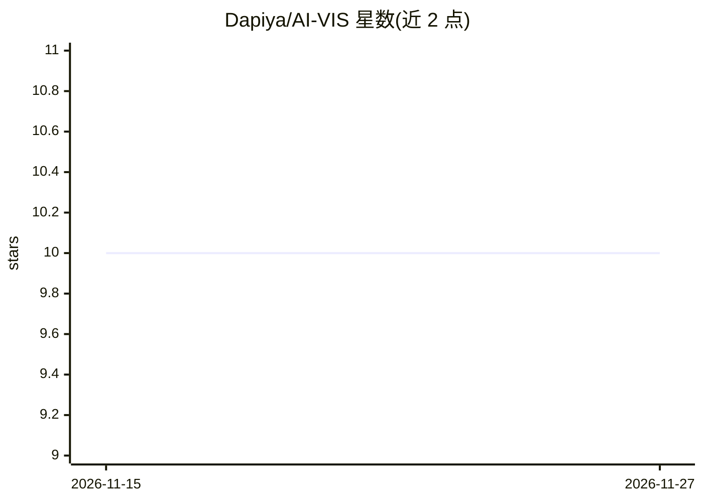

# Dapiya/AI-VIS

⭐ 10 · Python · Apache-2.0 · 推送 2026-01-15 · [GitHub](https://github.com/Dapiya/AI-VIS) · [官网](https://ai-vis.dapiya.top/) · 组织维护

**夜间红外通道生成可见光卫星图像的 CGAN 模型**

基于条件 GAN 的模型，从静止气象卫星的多个红外通道生成夜间可见光图像。模型在 Himawari-8/9 全圆盘与目标区域数据上训练，论文版本（aivis-1.0，67M 参数）发布于 HuggingFace；更先进的 1.5 版本需填写申请表获取。提供针对目标区域、全圆盘和浮标影像的推理脚本，支持 --upscale 与 --half-precision 选项。Apache 2.0 许可，附加条款要求公开图像须标注为 AI-VIS 生成。

## 筛选速览

| 维度 | 判定 | 备注 |
|---|---|---|
| AI 角色 | `ai-native` | 本体是模型或模型工具 |
| 许可风险 | `permissive` | Apache-2.0 |
| 部署形态 | `library` | 以包/库形式分发 |
| 模型依赖 | — | README 未给出锁定关系 |
| 硬件要求 | — | 无带数字的原话,不猜 |
| 安装摩擦 | `low` | 无编译、无系统依赖或容器化 |
| 成熟度 | — | 结构信号不足 |

## 能力要点

- CGAN 从红外通道生成夜间可见光卫星图像
- aivis-1.0 权重公开于 HuggingFace，1.5 版本经申请表获取
- 提供全圆盘、目标区域、浮标影像三套推理脚本
- 训练数据集与训练代码另行发布于 HuggingFace/GitHub

## 适用场景

- 生成夜间台风等热带气旋的可见光卫星影像
- 在 GOES-R 系列卫星数据上测试红外转可见光效果
- 下载官方测试数据直接运行示例推理

## 场景标签

`图像生成` · 领域:内容生成

## 证据(README 行号)

> L3: AI-VIS is a Conditional GAN(CGAN) based model that simulates visible imagery from multiple IR channels of geostation
> L7: The model is trained on Himawari-8/9 Full Disk and Target Area data. The model has been tested on other modern satel

## 星数曲线

2026-11-15 10 → 2026-11-27 10（+0）

---
*卡片 v1 · prompt 1.4 · 生成 2026-11-20 · 置信度 high · 依据 README sha `a66072ebef17` · [字段定义](../../DATASET.md)*
