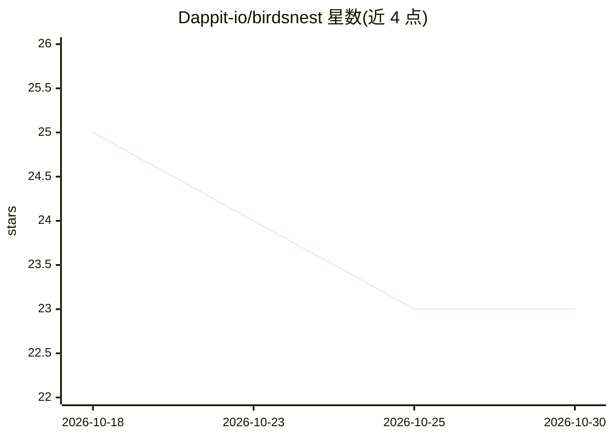

# Dappit-io/birdsnest

⭐ 23 · Python · MIT · 推送 2026-03-06 · [GitHub](https://github.com/Dappit-io/birdsnest) · 组织维护

**面向 Mac 的非 Transformer 本地 AI 聊天与生成工具集**

macOS 本地 AI 应用：以浏览器界面（localhost:7861）运行 RWKV、Mamba、xLSTM、StripedHyena 等 4 类非 Transformer 架构的 19 个文本模型，支持流式聊天、8 个图像模型本地生图、Stable Audio/Riffusion 音乐生成，内置 25+ 个可被模型对话中调用的工具（搜索、RAG、翻译、Python 等）。模型从 HuggingFace 下载至本地目录，无云端依赖与 API key。要求 macOS 12+、Python 3.11、最低 8GB 内存，Apple Silicon 可用 MLX 加速。

## 筛选速览

| 维度 | 判定 | 备注 |
|---|---|---|
| AI 角色 | `ai-native` | 本体是模型或模型工具 |
| 许可风险 | `permissive` | MIT |
| 部署形态 | `None` |  |
| 模型依赖 | — | README 未给出锁定关系 |
| 硬件要求 | — | 无带数字的原话,不猜 |
| 安装摩擦 | `low` | 无编译、无系统依赖或容器化 |
| 成熟度 | — | 结构信号不足 |

## 能力要点

- 运行 4 类非 Transformer 架构（RWKV/Mamba/xLSTM/StripedHyena）的 19 个文本模型
- 8 个图像模型本地生成，支持逐模型量化（Q4/Q8）
- 25+ 内置工具供本地模型对话中调用（搜索、RAG、音乐、YouTube 等）
- 零遥测、零 API key，模型与数据全部存于本地

## 适用场景

- 在 Mac 上本地聊天、生成图像与音乐而不依赖云端
- 一键下载并在多个非 Transformer 模型架构间切换
- 让本地模型调用搜索、RAG 等工具完成综合任务

## 场景标签

`聊天机器人` `图像生成` `RAG` · 领域:对话与助手

## 证据(README 行号)

> L5:  The First Local AI Manager for Non-Transformer Models
> L7:  Run RWKV, Mamba, xLSTM, and StripedHyena locally on your Mac.
> L30:  Chat Interface
> L40:  On-device image generation — your RNN calls tools mid-conversation to create images locally

## 星数曲线

2026-10-18 25 → 2026-10-30 23（-2）

---
*卡片 v1 · prompt 1.4 · 生成 2026-10-27 · 置信度 high · 依据 README sha `b65b0351fe4d` · [字段定义](../../DATASET.md)*
