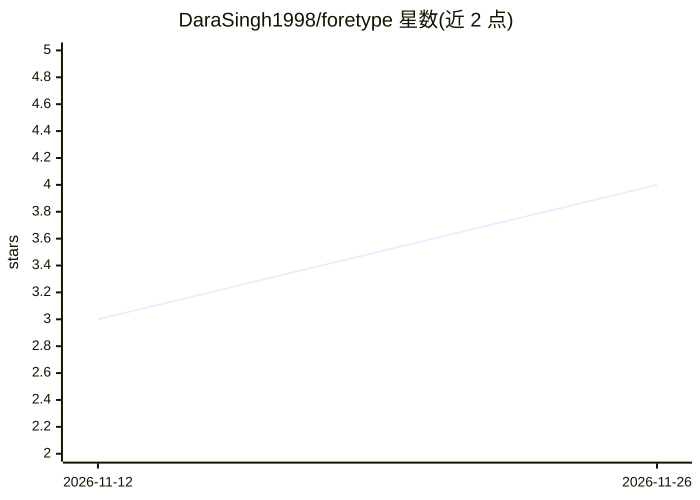

# DaraSingh1998/foretype

⭐ 4 · Swift · Apache-2.0 · 推送 2026-10-31 · [GitHub](https://github.com/DaraSingh1998/foretype) · 个人维护

**macOS 全局内联自动补全工具：本地 LLM 帮你少打字**

以菜单栏应用形式在几乎所有 macOS 应用中提供内联文字补全：输入时在光标后以灰色显示预测的句子的剩余部分，按 Tab 接受下一词或一键接受全部。核心为可移植 Rust 实现（提示、按应用规则、进程内 llama.cpp 前缀缓存与 token healing），外层为通过 Accessibility API 读取输入框并输出文字的 Swift 壳。模型在本地 GPU 运行，文本不上传；安装时按机器内存自动下载适配的模型。需要 Apple silicon 与 macOS 14+，当前仅支持 macOS。

## 筛选速览

| 维度 | 判定 | 备注 |
|---|---|---|
| AI 角色 | `ai-native` | 本体是模型或模型工具 |
| 许可风险 | `permissive` | Apache-2.0 |
| 部署形态 | `None` |  |
| 模型依赖 | local-ok | 支持本地模型 |
| 硬件要求 | — | 无带数字的原话,不猜 |
| 安装摩擦 | `low` | 无编译、无系统依赖或容器化 |
| 成熟度 | `idea` | |

## 能力要点

- 系统级内联补全，覆盖邮件、聊天、浏览器等应用及终端中的 AI coding agent 提示框
- 本地模型推理（llama.cpp），支持 Qwen3/Gemma 多档模型并可自定义内存档位
- 隐私机制：密码字段不读取、敏感信息掩码、历史加密存储、窗口文本仅驻留内存
- 可选上下文能力：OCR 读取周边窗口内容、学习个人写作风格、个人资料填充

## 适用场景

- 在邮件、聊天、表单等日常输入中减少按键次数
- 本地推理场景下避免输入内容外发
- 让补全参考正在回复的消息或旁侧打开的文档内容
- 让补全匹配个人常用措辞

## 场景标签

 · 领域:效率工具/桌面应用

## 证据(README 行号)

> L14: As you type, Foretype shows the likely rest of your sentence in gray right after the caret,
> L77: - The language model runs on your Mac's GPU. What you type is never sent anywhere.
> L138: Foretype is a portable Rust core (prompting, per-app rules, in-process llama.cpp with

## 星数曲线

2026-11-12 3 → 2026-11-26 4（+1）

---
*卡片 v1 · prompt 1.4 · 生成 2026-11-22 · 置信度 high · 依据 README sha `3174df15a300` · [字段定义](../../DATASET.md)*
