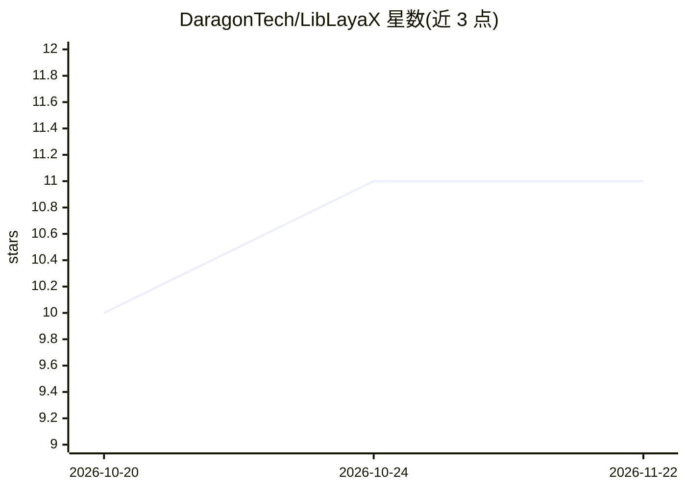

# DaragonTech/LibLayaX

⭐ 11 · C++ · MIT · 推送 2026-10-05 · [GitHub](https://github.com/DaragonTech/LibLayaX) · 组织维护

**把 Laya 决策模型嵌入应用的进程内 C 库，本地快速分类打分**

基于 laya.cpp 构建的非官方共享库与 C API，将 Laya 类型化决策模型（ModernBERT/multi语 mmBERT）以进程内函数调用方式运行，不做文本生成，单次前向返回标签与概率，支持 noul/choice/score 三种问题类型。目标用户是需要把 AI 决策嵌入桌面或服务器应用的 C/C++/Delphi/Rust/Lua 等开发者。模型不随库发布，需从 Hugging Face 下载（约 800 MB，加载约 1.7 GB 内存）；CPU 全平台可用，GPU 通过 Vulkan 后端运行；提供 Windows/Linux/macOS、x64 与 ARM64 二进制包及测试、基准工具。

## 筛选速览

| 维度 | 判定 | 备注 |
|---|---|---|
| AI 角色 | `ai-native` | 本体是模型或模型工具 |
| 许可风险 | `permissive` | MIT |
| 部署形态 | `library` | 以包/库形式分发 |
| 模型依赖 | — | README 未给出锁定关系 |
| 硬件要求 | — | 无带数字的原话,不猜 |
| 安装摩擦 | `medium` | 含编译或系统依赖之一 |
| 成熟度 | — | 结构信号不足 |

## 能力要点

- 进程内函数调用运行推理，无 HTTP、无服务器、无 Python 依赖
- 十个 C 函数的 API，JSON 进出，可从 C/C++/Delphi/Rust/Lua 等语言加载调用
- 六个平台目标：Windows/Linux/macOS 的 x64 与 ARM64，CPU 或 Vulkan GPU
- 一次调用可批量发送多个问题与多段文本，附 laya-bench 基准工具

## 适用场景

- 在工单系统里路由或标记支持请求
- 对文档批量判断是否需要人工审核
- 在离线或数据不出本机的环境做意图识别与情绪打分

## 场景标签

`推理引擎` · 领域:训练与推理

## 证据(README 行号)

> L5: **Fast local AI decisions inside your application.** LibLayaX runs the Laya AI model
> L36: LibLayaX closes that gap. It turns the laya.cpp inference engine into one library file that an
> L45: * **From the language the application is already written in.** Ten plain C functions with

## 星数曲线

2026-10-20 10 → 2026-11-22 11（+1）

---
*卡片 v1 · prompt 1.4 · 生成 2026-11-19 · 置信度 mid · 依据 README sha `105594c50f1d` · [字段定义](../../DATASET.md)*
