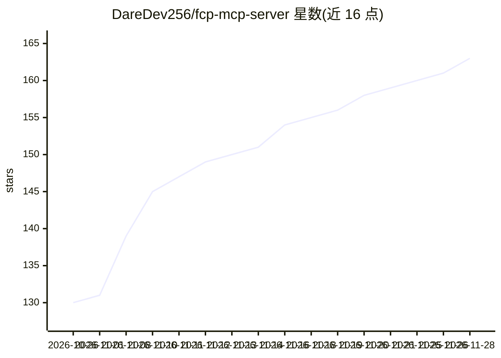

# DareDev256/fcp-mcp-server

⭐ 163 · Python · MIT · 推送 2026-11-27 · [GitHub](https://github.com/DareDev256/fcp-mcp-server) · [官网](https://pypi.org/project/fcp-mcp-server/) · 个人维护

**让 Claude 读写与编辑 Final Cut Pro 时间线的 MCP 服务器**

一个 MCP 服务器，将 Final Cut Pro 的时间线以 FCPXML 形式接入 Claude 等 MCP 客户端：读取、编辑并生成时间线，覆盖剪切检测、标记、角色分配、转录编辑、关键帧与变速等 102 种操作；提供 ui://fcp/timeline 内联可视化预览，所有写入带 sha256 日志、可撤销，生成类操作采用先报价后确认机制。以 pip/uvx 安装，另支持 Live Mode 通过 Apple 事件把 FCPXML 直接推入运行中的 Final Cut Pro；非插件，不运行在 Final Cut 内部。

## 筛选速览

| 维度 | 判定 | 备注 |
|---|---|---|
| AI 角色 | `ai-enhanced` | 去掉 AI 部分产品仍成立 |
| 许可风险 | `permissive` | MIT |
| 部署形态 | `library` | 以包/库形式分发 |
| 模型依赖 | — | README 未给出锁定关系 |
| 硬件要求 | — | 无带数字的原话,不猜 |
| 安装摩擦 | `medium` | 含编译或系统依赖之一 |
| 成熟度 | — | 结构信号不足 |

## 能力要点

- 15 组工具、102 种时间线操作（修剪、分割、静音移除、标记、粗剪、关键帧、变速）
- view 工具返回精确有理数时间 JSON，可在 MCP Apps 宿主内联绘制时间线
- 每次写入带 sha256 日志且可撤销，生成操作为 quote-then-confirm 加每调用上限
- Live Mode 通过 Open Document Apple 事件零点击推入运行中的 Final Cut Pro

## 适用场景

- 用自然语言让 Claude 批量剪切静音段、逐个动作加标记、铺 B-roll
- 从转录中生成章节标记或做转录级剪辑
- 对婚礼片等项目做时间线健康检查等批量 QC 操作
- 把 AI 生成或修改的粗剪直接推入运行中的 Final Cut Pro 继续剪辑

## 场景标签

`图像视频处理` · 领域:感知与多模态

## 证据(README 行号)

> L3: **Edit Final Cut Pro by talking to Claude, and watch the cut change.**
> L58: **Cut it.** 15 grouped tools, 102 operations: trims, splits, silence removal,
> L217: - **Not a plugin** — it doesn't run inside Final Cut Pro

## 星数曲线

2026-10-26 130 → 2026-11-28 163（+33）

---
*卡片 v1 · prompt 1.4 · 生成 2026-11-27 · 置信度 high · 依据 README sha `5a6d7496268c` · [字段定义](../../DATASET.md)*
