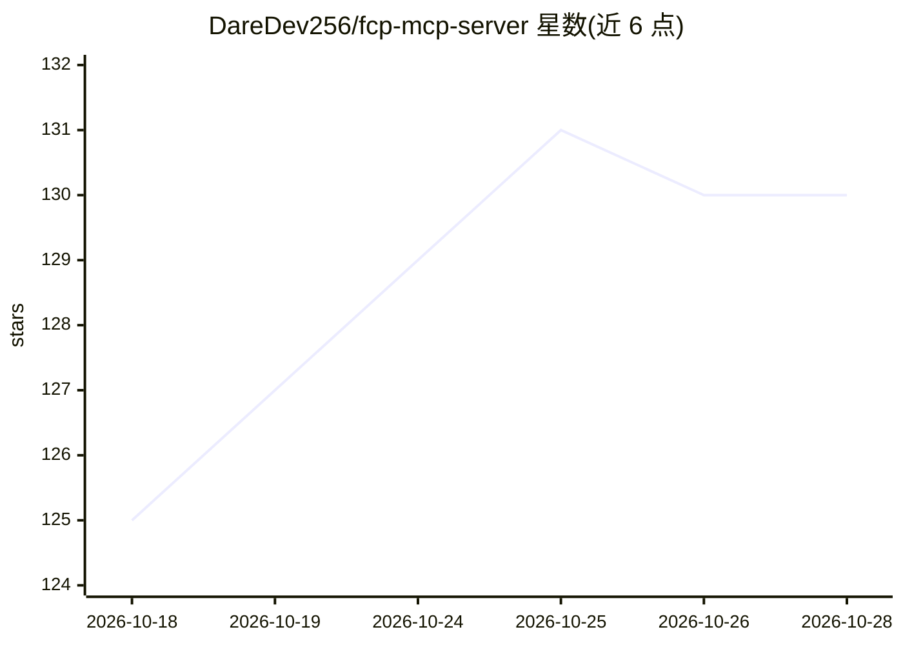

# DareDev256/fcp-mcp-server

⭐ 130 · Python · MIT · 推送 2026-10-24 · [GitHub](https://github.com/DareDev256/fcp-mcp-server) · [官网](https://pypi.org/project/fcp-mcp-server/) · 个人维护

**让 Claude 读写 Final Cut Pro XML 时间线的 MCP 服务器**

面向 Claude 等 MCP 客户端的 Final Cut Pro 剪辑服务器：解析 FCPXML 为有理数时间的 Python 对象，提供 15 组工具共 102 项操作，覆盖修剪、分割、静音移除、基于转写字幕的标记、粗剪生成、关键帧与变速、跨 NLE 导出等；macOS Live Mode 可经 Apple 官方事件推送结果到运行中的 FCP，但 Apple 无程序化导出，回程仍需手动 Export XML。每次写入带 sha256 日志可撤销，182 个对抗输入安全测试，通过 uvx/PyPI 安装。

## 筛选速览

| 维度 | 判定 | 备注 |
|---|---|---|
| AI 角色 | `ai-ecosystem` | LLM/agent 周边工具 |
| 许可风险 | `permissive` | MIT |
| 部署形态 | `library` | 以包/库形式分发 |
| 模型依赖 | — | README 未给出锁定关系 |
| 硬件要求 | — | 无带数字的原话,不猜 |
| 安装摩擦 | `medium` | 含编译或系统依赖之一 |
| 成熟度 | — | 结构信号不足 |

## 能力要点

- 15 组工具共 102 项操作：剪辑、标记、粗剪、变速、跨 NLE 导出
- 时间值全程有理数分数运算，任何帧率下无舍入误差
- 写入均带 sha256 日志可撤销，deliver 拒绝未审核剪辑
- Live Mode 经 Apple 官方事件零点击推送到运行中的 FCP

## 适用场景

- 让 Claude 从转写字幕批量插入章节标记
- 交付前做时间线健康检查并自动修复闪帧与空隙
- 从打标签的素材自动生成粗剪并推回 Final Cut Pro
- 导出 EDL/CSV 做剪辑数据提取

## 场景标签

 · 领域:视频剪辑/Agent 工具集成

## 证据(README 行号)

> L24: **Cut it.** 15 grouped tools, 102 operations: trims, splits, silence removal,
> L35: claude mcp add fcpxml -e FCP_PROJECTS_DIR=~/Movies -- uvx fcp-mcp-server
> L153:   ┌──────────┐      ┌──────────────────────────────┐      ┌──────────┐

## 星数曲线

2026-10-18 125 → 2026-10-28 130（+5）

---
*卡片 v1 · prompt 1.4 · 生成 2026-10-23 · 置信度 high · 依据 README sha `52516c118941` · [字段定义](../../DATASET.md)*
