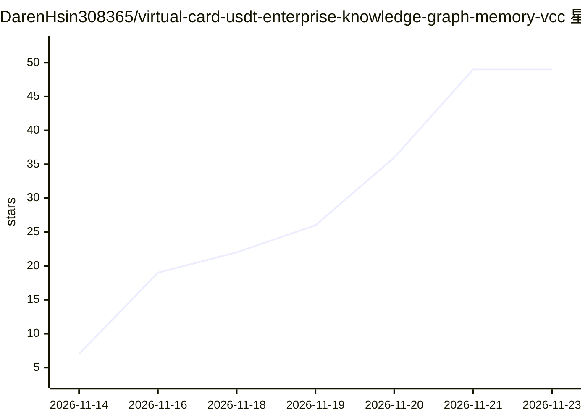

# DarenHsin308365/virtual-card-usdt-enterprise-knowledge-graph-memory-vcc

⭐ 49 · 推送 2026-11-13 · [GitHub](https://github.com/DarenHsin308365/virtual-card-usdt-enterprise-knowledge-graph-memory-vcc) · [官网](https://app.coregold.io/signup?invite_code=ADvlj9b) · 组织维护 · 中文 README

**CoreGold 虚拟卡营销文：用 VCC 隔离 GraphRAG 服务的订阅扣款**

非软件仓库，是一篇面向企业 AI 记忆层部署场景的 CoreGold 商业虚拟卡推广文档：以 GraphRAG/Zep/Mem0/Neo4j Aura 管道的 API 订阅扣款风险（银行锁卡、索引死循环账单穿透、Stripe AVS 核验）为切入点，说明如何用 USDT 充值 CoreGold 资金池、按组件签发带硬限额的独立 VCC 并配合 Apple Pay 完成支付。不含代码、安装步骤或可运行产物，末尾附开卡入口与一段哈希。

## 筛选速览

| 维度 | 判定 | 备注 |
|---|---|---|
| AI 角色 | `ai-knowledge` | 知识聚合/清单类 |
| 许可风险 | `none` | — |
| 部署形态 | `None` |  |
| 模型依赖 | — | README 未给出锁定关系 |
| 硬件要求 | — | 无带数字的原话,不猜 |
| 安装摩擦 | `low` | 无编译、无系统依赖或容器化 |
| 成熟度 | — | 结构信号不足 |

## 能力要点

- 以 GraphRAG/记忆引擎生产部署的支付风险为叙述框架
- 给出按组件拆分 VCC 与硬限额的支付拓扑示意
- 描述 USDT(TRC20/ERC20) 充值、发卡、调额回收的操作流程

## 适用场景

- 了解 AI 检索管道多供应商并发扣款的支付风险叙述
- 作为 CoreGold 虚拟卡服务的推广入口

## 场景标签

 · 领域:支付服务/营销内容

## 证据(README 行号)

> L3: # ⚡ 企业级 GraphRAG 与长程记忆层：用 USDT 商业虚拟卡（VCC）焊死多源检索索引账单
> L7: 然而，构建一套全天候自动消解实体关系并持续更新图谱的生产级管道，在支付清算层面暗藏极高风险：全量历史文档重建索引时，Embedding 与图谱抽取接口会在数小时内高频触发自动充值（Auto-Topup），国内个人双币卡极易触发发卡行
> L40: 👉 **立即进入 CoreGold 官方开卡控制台**

## 星数曲线

2026-11-14 7 → 2026-11-23 49（+42）

---
*卡片 v1 · prompt 1.4 · 生成 2026-11-18 · 置信度 high · 依据 README sha `23564630f848` · [字段定义](../../DATASET.md)*
