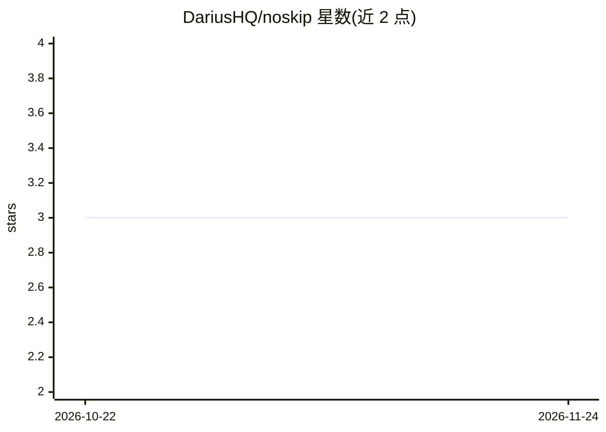

# DariusHQ/noskip

⭐ 3 · JavaScript · MIT · 推送 2026-10-10 · [GitHub](https://github.com/DariusHQ/noskip) · [官网](https://www.npmjs.com/package/noskip) · 组织维护

**检测 AI 编程 agent 跳过/削弱测试作弊行为的 CLI**

noskip 是面向开发者的 AI agent 反作弊工具：当 Claude Code、Codex、Cursor、Gemini 等 agent 通过跳过、删除或削弱断言使失败测试变绿、硬编码答案或关闭 CI 时，对工作树快照与当前状态的 diff 运行 28 条规则判定，命中后带着文件、行号和修复建议把 agent 打回重做，或在 PR 上标注违规行。本地确定性运行，无 LLM、无网络、零依赖，支持 git pre-commit、各 agent hooks 与 GitHub Action 集成，附 CheatBench 基准与历史 commit 审计命令。

## 筛选速览

| 维度 | 判定 | 备注 |
|---|---|---|
| AI 角色 | `ai-ecosystem` | LLM/agent 周边工具 |
| 许可风险 | `permissive` | MIT |
| 部署形态 | `library` | 以包/库形式分发 |
| 模型依赖 | — | README 未给出锁定关系 |
| 硬件要求 | — | 无带数字的原话,不猜 |
| 安装摩擦 | `low` | 无编译、无系统依赖或容器化 |
| 成熟度 | — | 结构信号不足 |

## 能力要点

- 对 diff 运行 28 条规则，覆盖 14 种语言的 skip/削弱/硬编码/CI 关闭检测
- 通过 hooks 或 Claude Code 插件拦截 agent，命中后打回并给出定位与修复
- noskip audit 回放 git 历史识别 AI 参与 commit 中的测试作弊
- 零依赖离线运行，SARIF 输出接入 GitHub code scanning

## 适用场景

- 防止 AI agent 在 PR 中通过改测试让套件变绿
- 审计仓库历史中 AI 写的 commit 是否动过测试
- CI 中阻断关闭测试检查的提交

## 场景标签

`代码审查` · 领域:编码与开发

## 证据(README 行号)

> L7: noskip catches Claude Code, Codex, Cursor and Gemini when they make a failing test "pass" by skipping it,
> L144: 2. **The agent tries to finish.** noskip diffs the snapshot against the current state and runs 28 rules over what 
> L159: - **Local and deterministic.** No LLM, no network, no telemetry, zero dependencies. Same diff, same verdict.

## 星数曲线

2026-10-22 3 → 2026-11-24 3（+0）

---
*卡片 v1 · prompt 1.4 · 生成 2026-11-22 · 置信度 high · 依据 README sha `28d749411526` · [字段定义](../../DATASET.md)*
