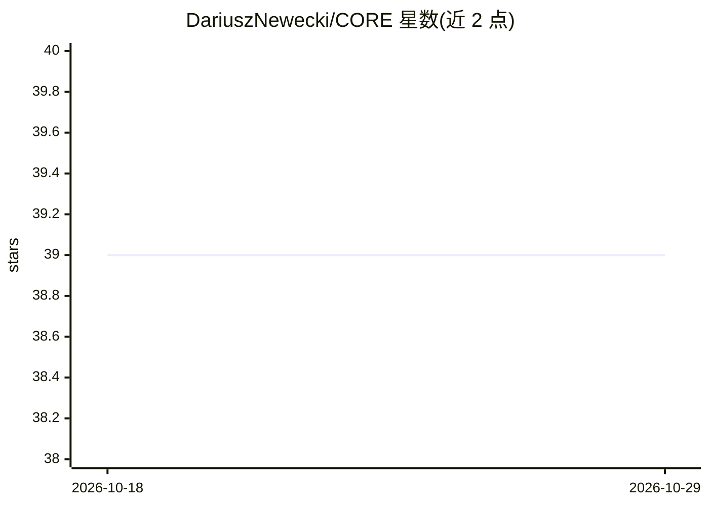

# DariuszNewecki/CORE

⭐ 39 · Python · MIT · 推送 2026-10-28 · [GitHub](https://github.com/DariuszNewecki/CORE) · [官网](https://dariusznewecki.github.io/CORE/) · 个人维护

**AI 辅助开发的宪法治理运行时：审计代码、人工批准变更**

CORE 是面向 AI 辅助软件开发的治理运行时：仓库内以 .intent/ 声明规则，CORE 对代码库做离线审计、记录违规、提出修复建议，并记录从发现到提交的完整链条。AI 助手与 CORE 自身循环可提议变更，但仅人类治理者可批准。pip 安装即提供离线审计、GitHub Action 每次 PR 审计，以及通过 MCP 让 AI 助手提交前查询规则与获取裁决；完整本地运行时（Postgres + Qdrant）需从源码克隆并以 Docker Compose 运行。要求 Python 3.12+ 与 git。

## 筛选速览

| 维度 | 判定 | 备注 |
|---|---|---|
| AI 角色 | `ai-ecosystem` | LLM/agent 周边工具 |
| 许可风险 | `permissive` | MIT |
| 部署形态 | `library` | 以包/库形式分发 |
| 模型依赖 | — | README 未给出锁定关系 |
| 硬件要求 | — | 无带数字的原话,不猜 |
| 安装摩擦 | `low` | 无编译、无系统依赖或容器化 |
| 成熟度 | — | 结构信号不足 |

## 能力要点

- 以 .intent/ 声明宪法规则并对代码库做离线审计
- 变更链路从发现到提交全程留痕，仅人类治理者可批准
- MCP 接入 AI 助手（任意 MCP 客户端可用），提交前获取规则裁决
- 提供 GitHub Action 在每次 PR 上执行审计

## 适用场景

- 在 AI 助手写代码的仓库中执行规则审计与治理
- 要求 AI 提议的变更必须经人工批准才可提交
- CI 中对每次 PR 自动执行宪法规则审计

## 场景标签

`代码审查` · 领域:编码与开发

## 证据(README 行号)

> L13: CORE audits a codebase against declared rules in `.intent/`, records every
> L15: assistants and CORE's own loop can propose changes; only the human governor
> L63: Connect your AI assistant (Claude Code shown; any MCP client works) so it asks

## 星数曲线

2026-10-18 39 → 2026-10-29 39（+0）

---
*卡片 v1 · prompt 1.4 · 生成 2026-10-25 · 置信度 high · 依据 README sha `5ff85306f8d5` · [字段定义](../../DATASET.md)*
