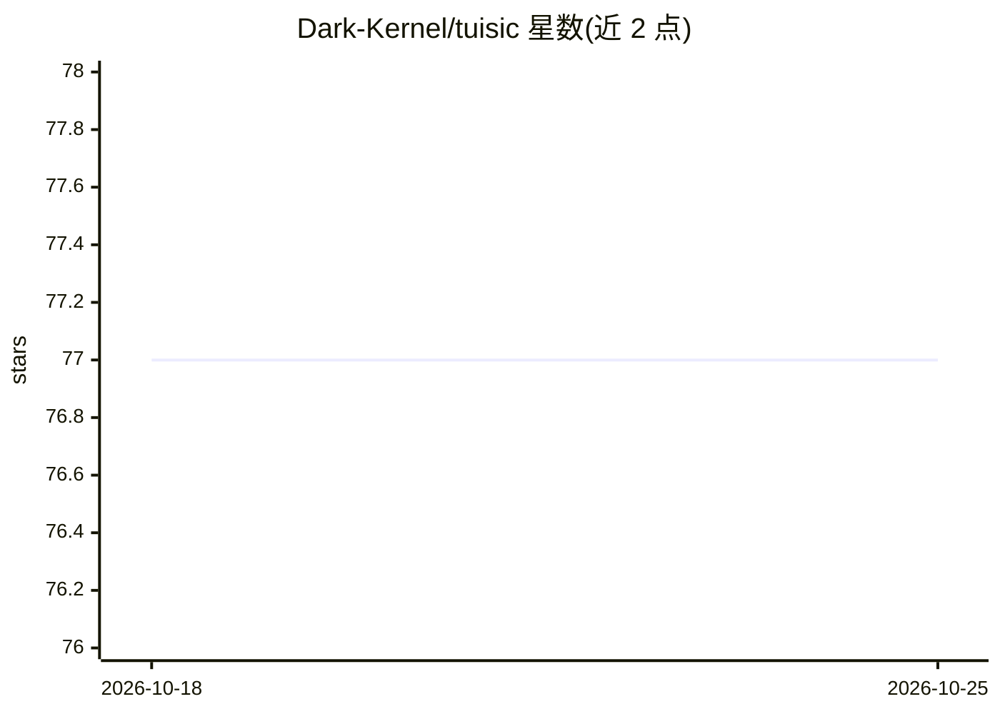

# Dark-Kernel/tuisic

⭐ 77 · C++ · GPL-3.0 · 推送 2026-09-16 · [GitHub](https://github.com/Dark-Kernel/tuisic) · [官网](https://dark-kernel.github.io/tuisic/) · 个人维护

**带 Vim 键位与 MCP 集成的 C++ 终端在线音乐播放器**

用 C++ 与 FTXUI 编写的终端 UI 音乐流媒体应用，支持从 JioSaavn、SoundCloud、LastFM、YouTube 等平台搜索、播放、下载歌曲，另支持本地音乐库播放。功能包括 Vim 键位、播放列表、收藏、歌词（BETA）、MPRIS DBus、Cava 可视化、Discord Rich Presence 与守护模式。通过 tuisic --mcp-server 可作为 MCP 服务器接入 AI 客户端（BETA），实现 AI 集成。提供 AUR 包，Debian/Arch/macOS 需从源码编译安装。

## 筛选速览

| 维度 | 判定 | 备注 |
|---|---|---|
| AI 角色 | `ai-enhanced` | 去掉 AI 部分产品仍成立 |
| 许可风险 | `viral` | GPL-3.0 |
| 部署形态 | `None` |  |
| 模型依赖 | — | README 未给出锁定关系 |
| 硬件要求 | — | 无带数字的原话,不猜 |
| 安装摩擦 | `medium` | 含编译或系统依赖之一 |
| 成熟度 | `idea` | |

## 能力要点

- 多平台在线音源搜索、播放与下载（JioSaavn/SoundCloud/YouTube 等）
- Vim 键位操作与本地音乐库播放（默认扫描 ~/Music，经 mpv 播放）
- MCP 服务器模式（BETA），可接入 opencode 等 AI 客户端
- MPRIS DBus、Cava 可视化、Discord Rich Presence 支持

## 适用场景

- 在终端里搜索并播放在线歌曲，不用浏览器
- 通过 AI 客户端以 MCP 方式控制音乐播放
- 用 Vim 键位管理播放列表、收藏与下载

## 场景标签

 · 领域:音乐/桌面终端应用

## 证据(README 行号)

> L3: TUI Online Music Streaming application with MCP support
> L21: - Support for AI Integration via MCP (BETA)
> L171: Use `tuisic --mcp-server` command in your ai client config.

## 星数曲线

2026-10-18 77 → 2026-10-25 77（+0）

---
*卡片 v1 · prompt 1.4 · 生成 2026-10-24 · 置信度 high · 依据 README sha `db963b1dc60f` · [字段定义](../../DATASET.md)*
