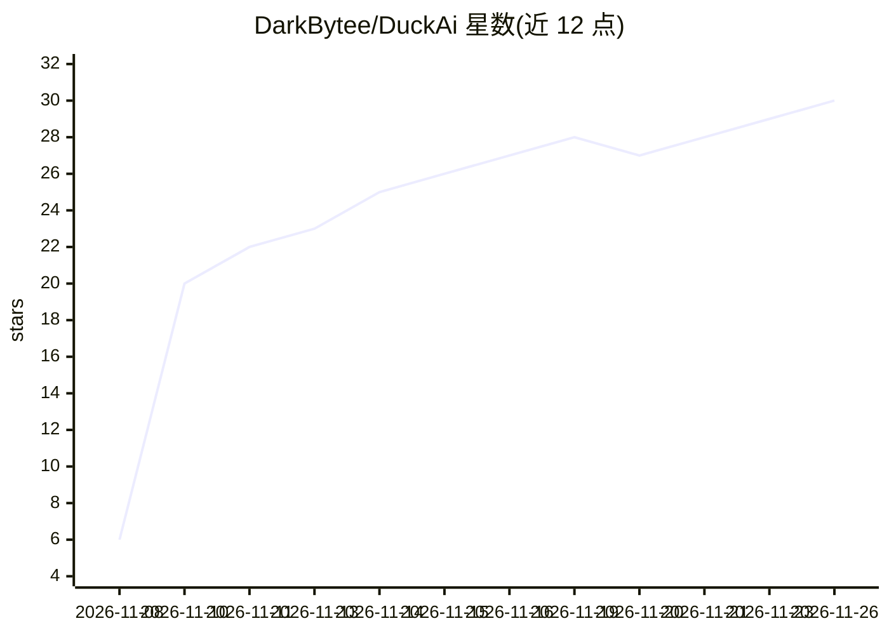

# DarkBytee/DuckAi

⭐ 30 · Python · MIT · 推送 2026-11-08 · [GitHub](https://github.com/DarkBytee/DuckAi) · 个人维护

**非官方免费 CLI：在终端使用 duck.ai 的聊天/图像/语音功能**

Python 命令行工具，通过逆向 duck.ai 浏览器握手（本地用 Node.js + jsdom 求解反滥用 JS 挑战）接入其私有端点，无需 API key 与账号。提供流式对话（6 个免费模型：GPT-6 Luna、GPT-5.4 Mini、Claude Haiku 5.5、Mistral、gpt-oss-120b、Gemma 4 31B）、图片输入、文生图、文件附件、听写转写与 WebRTC 双向实时语音通话。支持 HTTP/SOCKS5 代理，界面为英文/波斯语。限制：使用未公开端点，声明可能随时失效，须遵守 DuckDuckGo 服务条款。

## 筛选速览

| 维度 | 判定 | 备注 |
|---|---|---|
| AI 角色 | `ai-native` | 本体是模型或模型工具 |
| 许可风险 | `permissive` | MIT |
| 部署形态 | `desktop` | 安装包/桌面程序 |
| 模型依赖 | — | README 未给出锁定关系 |
| 硬件要求 | — | 无带数字的原话,不猜 |
| 安装摩擦 | `low` | 无编译、无系统依赖或容器化 |
| 成熟度 | — | 结构信号不足 |

## 能力要点

- 流式对话，6 个免费模型可在会话中切换
- 文生图（JPEG 保存）与图片/文件附件输入
- WebRTC 实时双向语音通话与麦克风/音频文件听写
- 本地 Node.js + jsdom 求解反滥用挑战，无需浏览器

## 适用场景

- 在终端免费使用 duck.ai 的多模型对话
- 命令行里生成图片或让 AI 审查代码文件
- 与 AI 进行实时语音通话或把音频转文字

## 场景标签

`聊天机器人` `语音 Agent` `图像生成` `语音识别` · 领域:对话与助手

## 证据(README 行号)

> L27: DuckAi is a small Python CLI that gives you the **same AI chat you get on duck.ai — in your terminal, for free**. I
> L39: |🔀|**6 free models**|GPT-6 Luna · GPT-5.4 Mini · Claude Haiku 5.5 · Mistral · gpt-oss · Gemma 4|

## 星数曲线

2026-11-08 6 → 2026-11-26 30（+24）

---
*卡片 v1 · prompt 1.4 · 生成 2026-11-18 · 置信度 mid · 依据 README sha `2ed742ae6455` · [字段定义](../../DATASET.md)*
