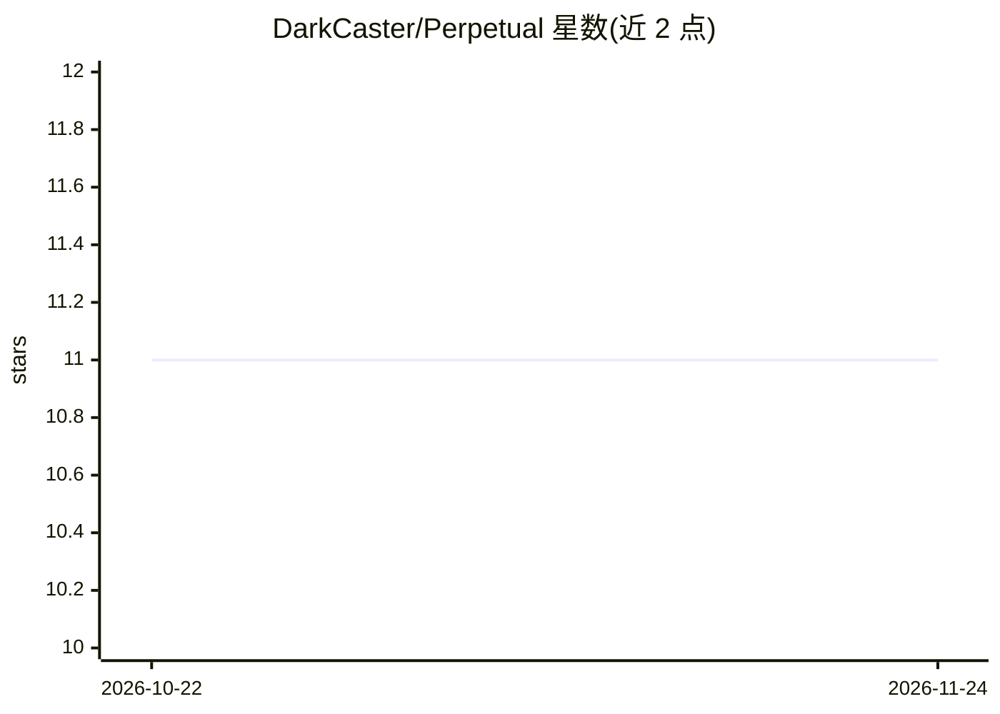

# DarkCaster/Perpetual

⭐ 11 · Go · MIT · 推送 2026-11-13 · [GitHub](https://github.com/DarkCaster/Perpetual) · 个人维护

**开发者的命令行 AI 编码助手：按文字描述生成与修改代码**

以命令行工具形式运行的 LLM 软件开发助手：分析项目代码库，根据文本任务、stdin 管道输入或源码中标记的 ###IMPLEMENT### 注释生成与修改代码，另支持生成代码注释、向量嵌入、Markdown 报告、文档撰写与代码问答。支持按任务类型将不同工作分配给不同模型/提供商以平衡成本。修改前自动备份并生成可回滚的 stash；工作范围严格限制在项目目录内。提供 GitHub Releases 可执行文件，需自备 LLM API key。

## 筛选速览

| 维度 | 判定 | 备注 |
|---|---|---|
| AI 角色 | `ai-native` | 本体是模型或模型工具 |
| 许可风险 | `permissive` | MIT |
| 部署形态 | `None` |  |
| 模型依赖 | local-ok | 支持本地模型 |
| 硬件要求 | — | 无带数字的原话,不猜 |
| 安装摩擦 | `low` | 无编译、无系统依赖或容器化 |
| 成熟度 | — | 结构信号不足 |

## 能力要点

- task 模式管道输入与 ###IMPLEMENT### 注释两种代码生成方式
- 多模型分任务调度：注释/规划用低成本模型，写码用高阶模型
- 自动备份 + stash 回滚/重放机制
- stdin/stdout 接口设计，可嵌入多 agent 系统作为写码工具

## 适用场景

- 在项目根目录用自然语言任务直接生成新代码
- 在源码指定位置标记注释让 AI 就地实现函数
- 为项目批量生成注释、嵌入与文档，或向 LLM 问答项目细节

## 场景标签

`代码生成` · 领域:编码与开发

## 证据(README 行号)

> L7: `Perpetual` is an LLM-driven software development assistant designed to enhance the productivity and efficiency of s
> L33: Currently, the assistant supports working with OpenAI, Anthropic, Ollama, and generic OpenAI-compatible providers (

## 星数曲线

2026-10-22 11 → 2026-11-24 11（+0）

---
*卡片 v1 · prompt 1.4 · 生成 2026-11-19 · 置信度 high · 依据 README sha `ad4ef7353178` · [字段定义](../../DATASET.md)*
