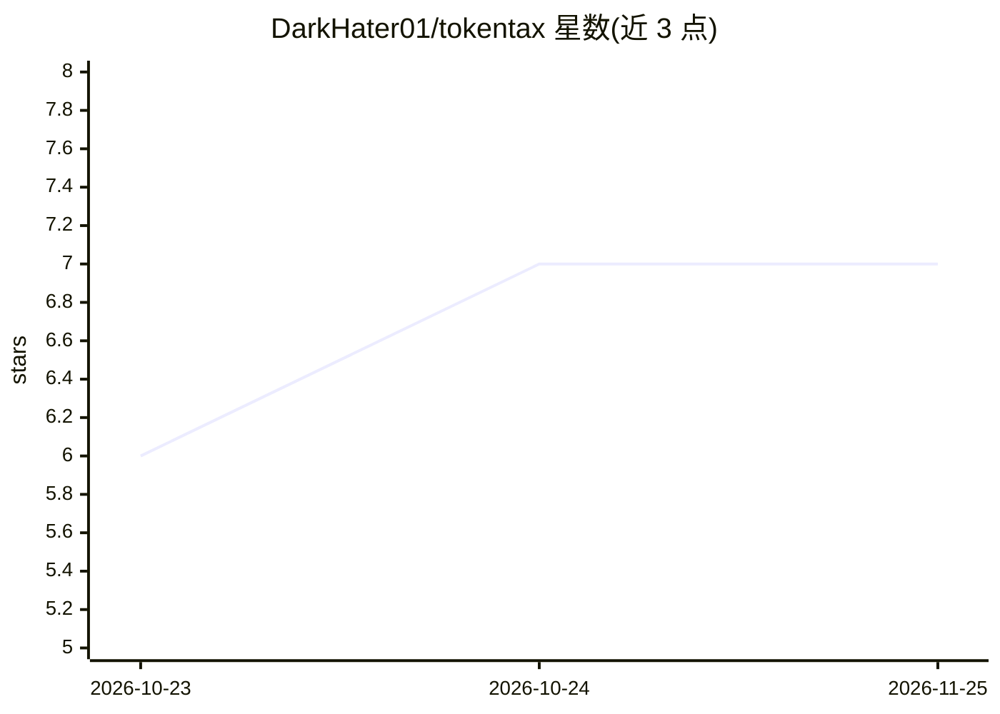

# DarkHater01/tokentax

⭐ 7 · JavaScript · MIT · 推送 2026-11-23 · [GitHub](https://github.com/DarkHater01/tokentax) · [官网](https://darkhater01.github.io/tokentax/) · 个人维护

**AI agent token 浪费测量基准：tax=花费/必要，按模型×harness 排名**

TokenTax 是一个测量 agent token 开销中浪费比例的基准工具，核心指标 tax = (tokens_in+tokens_out)/necessary_tokens，按 模型×harness 排名，区分浪费来自模型还是 harness。分母从任务自身文件重建（提示词下限、工具 schema、必读文件、补丁），可经 PR 争议修正。评分器含多重校验守卫，生成代码在硬化容器中运行，任务带隐藏测试与参考解并由 CI 验证。零依赖，Node>=22 运行；离线 demo 无需 key，真实运行需 provider key 与 Docker。

## 筛选速览

| 维度 | 判定 | 备注 |
|---|---|---|
| AI 角色 | `ai-ecosystem` | LLM/agent 周边工具 |
| 许可风险 | `permissive` | MIT |
| 部署形态 | `None` |  |
| 模型依赖 | — | README 未给出锁定关系 |
| 硬件要求 | — | 无带数字的原话,不猜 |
| 安装摩擦 | `low` | 无编译、无系统依赖或容器化 |
| 成熟度 | — | 结构信号不足 |

## 能力要点

- tax 比率指标 + 按浪费排名的生成式 leaderboard
- model × harness 双轴，同一模型不同 harness 票据对比
- 分母 necessary_tokens 可争议（trajectory.json 可提 PR 修改）
- 零依赖，离线 fixture demo 一条命令无 key 无网络

## 适用场景

- 测量我的 agent 在完成任务上浪费了多少 token
- 对比不同 harness 框架驱动同一模型的开销差异
- 跨模型比较 token 效率而非仅看价格

## 场景标签

`模型评测` · 领域:评测与运维

## 证据(README 行号)

> L10: **Every agent benchmark ranks how smart a model is. None ranks how much of the bill was waste.**
> L84: 2. **The harness axis.** Everyone ranks models. The bill is set by the harness — and nobody measures that.
> L160: **A real run — needs a provider key (see `runner/providers.json`):**

## 星数曲线

2026-10-23 6 → 2026-11-25 7（+1）

---
*卡片 v1 · prompt 1.4 · 生成 2026-11-20 · 置信度 high · 依据 README sha `898f347822b9` · [字段定义](../../DATASET.md)*
